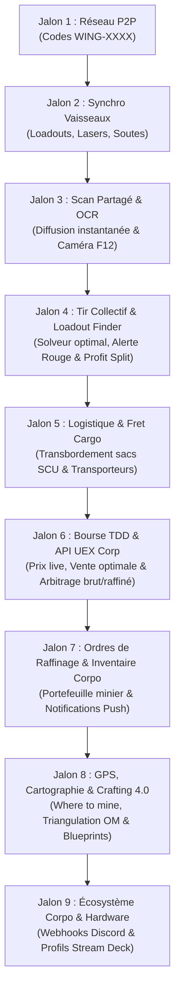

# 🗺️ FEUILLE DE ROUTE OFFICIELLE (ROADMAP) — AARON MFD
## Système d'Exploitation Tactique, Logistique, Commercial & Flotte Multijoueur (*Star Citizen 4.0+*)

> **Version active** : **v1.8.0** (Star Citizen Alpha 4.10) — **Jalons 1, 2 et 3 terminés & déployés** 🚀  
> **Direction stratégique du logiciel** : Élever AARON MFD au rang de **plateforme intégrale de référence pour les opérations industrielles de Star Citizen**.
> L'application réunit sous une même interface immersive (mobiGlas) l'ensemble des acteurs d'une opération : **éclaireurs, mineurs, transporteurs lourds, escorteurs de combat et gestionnaires de corporation**. Les calculs de puissance et de faisabilité, la synchronisation temps réel des vaisseaux, le partage instantané des scans de rochers, le transbordement de fret en vol, le suivi des ordres de raffinage, la cartographie GPS des filons et l'arbitrage commercial aux TDD sont orchestrés de manière fluide, 100% autonome et sans aucun serveur payant (P2P Serverless).

---

## 🎯 Vision & Principes Fondamentaux

1. **Zéro Serveur Payant & Souveraineté Totale (Serverless P2P) :**
   * Communication directe de navigateur à navigateur via **WebRTC DataChannels**.
   * Aucune base de données centralisée requise, aucun compte obligatoire, respect absolu de la vie privée.
   * Fonctionnement local résilient : utilisation d'un courtier de signalement gratuit (PeerJS Cloud / STUN Google) avec fallback local `BroadcastChannel` pour les tests multi-écrans sur le même poste ou réseau local.

2. **Chaîne de Valeur Industrielle Complète (Du Laser au TDD) :**
   * **1. Prospection & Scan OCR :** Détection de rochers, lecture optique par caméra / capture F12 et diffusion à la flotte.
   * **2. Fracturation & Extraction :** Puissance cumulée, solveur de loadout optimal (*Optimal Loadout Finder*), régulation thermique, assistance vocale et alertes d'instabilité.
   * **3. Sécurité & Escorte :** Sentinelle radar, bouton d'alerte rouge et prime de protection pour les chasseurs de combat.
   * **4. Logistique & Fret Spécialisé :** Transbordement en vol de sacs miniers / conteneurs SCU vers des cargos dédiés.
   * **5. Raffinage & Inventaire :** Gestionnaire d'ordres de raffinage, minuteries en arrière-plan, notifications push déportées et registre de corporation (*Corpo Mining Reserves*).
   * **6. Commerce, Vente TDD & API UEX Corp :** Analyse des cours du marché en temps réel (intégration API live UEX Corp avec cache hors-ligne), calcul des marges nettes et optimisation des routes de vente de cargaisons mixtes.
   * **7. Localisateur de Minerais & Crafting 4.0 :** Base de données des gisements (*Where to mine*) et suivi des blueprints de fabrication.
   * **8. Intégration Corpo & Matériel :** Webhooks Discord corporatifs automatiques et profils Stream Deck.

3. **Immersion Cockpit Authentique (Style mobiGlas Star Citizen 4.0+) :**
   * Interface sombre néon inspirée des cockpits de vaisseaux, voyants de comms chiffrées, ping en direct, indicatifs radio personnalisés (`CITIZEN-1`, etc.).
   * Synthèse vocale cockpit (TTS) et retours sonores immersifs.

4. **100% Hors-Ligne & Rétro-compatibilité :**
   * L'application reste utilisable à 100% en mode solo hors-ligne (PWA avec cache local).

---

## 🚀 Vue d'Ensemble des Jalons de Développement



---

### 📡 JALON 1 — Couche Réseau P2P & Connexion d'Escadre (*AARON FLEET-NET*) — [TERMINÉ / DISPONIBLE v1.8.0]
*Objectif : Permettre à un groupe de s'interconnecter en moins de 5 secondes sans inscription, en local et à distance via Internet.*

* **Système de Salons Rapides (Room Codes) :**
  * Génération automatique d'un identifiant d'escadre court et mémorisable (ex: `WING-4982` ou `STANTON-DELTA`).
  * Connexion par saisie du code ou via lien d'invitation 1-clic (`https://.../?fleet=WING-4982`).
* **Architecture Réseau Hybride (Internet + Local) :**
  * **WebRTC DataChannels (Internet P2P)** : Canaux de données directs de navigateur à navigateur chiffrés, traversée NAT via serveurs STUN publics (Google STUN) et passerelle PeerJS intégrée localement.
  * **BroadcastChannel (Local)** : Communication instantanée (< 1ms) inter-onglets et multi-écrans sur la même machine.
  * Nœud Hôte (Créateur de l'escadre) et Nœuds Pairs (Ailiers) avec Star-Mesh Relay.
  * Heartbeat / Ping temps réel pour surveiller la latence en millisecondes et la présence des pairs (timeouts > 8s).
* **Interface mobiGlas & MFD :**
  * Panneau dédié FLEET-NET dans la modale d'escouade : indicateur de statut (`SOLO (HORS-LIGNE)`, `CONNECTÉ (AARON FLEET-NET)`), diode pulsante verte.
  * Télémétrie en direct : affichage du ping RTT (`XX ms`) et nombre de pairs en ligne.
  * Voyant radio interactif `COMMS` dans l'en-tête système mobiGlas (`WING-XXXX [X pairs • Xms]`).

---

### 🛸 JALON 2 — Synchronisation Temps Réel des Vaisseaux & Configurations — [TERMINÉ / DISPONIBLE v1.8.0]
*Objectif : Quand un joueur modifie sa configuration, toute l'escadre est actualisée automatiquement.*

* **Diffusion Automatique des Équipements :**
  * **Vaisseau actif :** Prospector, MOLE, Arrastra, Orion, ROC, ROC-DS, vaisseaux cargos (C2, Taurus, RAFT, Freelancer MAX, Zeus CL, Hull).
  * **Armement minier :** Type de laser (Lancet, Helix, Arbor, Impact, Klein), taille (S1 ou S2).
  * **Tourelles actives :** Prise en compte dynamique des tourelles du MOLE (1 solo, 2 duo, 3 trio).
  * **Capacité de soute :** SCU disponible et cumulé de l'escadre.
  * **Identité radio :** Indicatif personnalisé du pilote (ex: `Ghost-Leader`, `Miner-02`).
* **Éditeur de Têtes de Minage & Gadgets Craftés (*Custom & Crafted Mining Heads*) :**
  *(Adapté au système de Crafting Star Citizen 4.0)*
  * **Création et clonage de têtes artisanales :** Les joueurs peuvent créer de nouvelles têtes personnalisées ou modifier les stats de têtes existantes (ex: *Lancet MH1 Tier 3 Craft*, *Helix Overclocké*).
  * **Réglage fin des caractéristiques :**
    * Puissance de fracture brute (Watts).
    * Modificateur de réduction de résistance rocheuse (% de bonus/malus).
    * Modificateur d'atténuation d'instabilité (%).
    * Taille et vitesse de charge de la fenêtre optimale (Optimal Window %).
    * Nombre d'emplacements de sous-modules (1, 2 ou 3 slots).
  * **Créateur de Gadgets Miniers Sur-Mesure :** Ajout de gadgets artisanaux ou prototypes de guilde avec réglages personnalisés des bonus de résistance, instabilité et fenêtre verte.
  * **Persistance & Synchronisation P2P :** Vos têtes et gadgets craftés sont sauvegardés dans votre profil local et automatiquement diffusés à vos coéquipiers lors de la connexion (`FLEET_SYNC`), afin que les calculateurs de toute l'escadre intègrent vos vraies statistiques artisanales.
* **Calculateur de Flotte Dynamique :**
  * Puissance combinée en Watts calculée et mise à jour en direct sur tous les écrans.
  * Réduction globale de résistance cumulée selon les lasers Lancet actifs.
  * Ajustement automatique du nombre de parts dans le module de partage de gains.

---

### 🪨 JALON 3 — Télémétrie de Scan Partagée & Scanner OCR Instantané — [TERMINÉ / DISPONIBLE v1.8.0]
*Objectif : Zéro saisie manuelle et mise à jour instantanée des MFD de la flotte dès qu'un rocher est scanné.*

* **Transmission Instantanée du Scan :**
  * Dès qu'un membre scanne un rocher (clavier, curseurs, voix ou OCR) :
    * Masse (kg), Archétype géologique, Minerais détectés et pourcentages, Résistance et Instabilité.
  * Diffusion en < 150 ms à tous les membres de la flotte.
  * Mise à jour automatique des jauges et calculs de faisabilité sur tous les MFD connectés.
  * Notification visuelle et synthèse vocale cockpit (*"📡 Scan reçu de [Callsign] : Rocher Quantainium 5 200 kg"*).
* **Scanner OCR Instantané (Caméra Smartphone / Capture d'Écran F12) :**
  *(Reconnaissance optique de scan instantanée)*
  * Pointez la caméra vers l'écran ou glissez une capture d'écran du réticule de scan de Star Citizen.
  * Moteur OCR 100% local (exécuté dans le navigateur sans envoyer d'image sur un serveur distant).
  * Extraction automatique en 0,3 seconde de toutes les valeurs et injection directe dans le calculateur.

---

### ⚡ JALON 4 — Coordination Tactique, Solveur Optimal & Escorte
*Objectif : Coordonner le tir conjoint des lasers, recommander le meilleur loadout et sécuriser la flottille.*

* **Solveur de Loadout Optimal (*Optimal Loadout Finder*) :**
  *(Algorithme prédictif de puissance et résistances)*
  * Pour un rocher donné particulièrement résistant, l'algorithme calcule et suggère immédiatement la configuration exacte de lasers et de modules à équiper (ex: *« Pour cette roche de 8 200 kg à 58% de résistance : Équiper Lancet MH1 + 2x Focus III + 1x Surge »* ou *« Duo requis : 1x Lancet + 1x Helix »*).
* **Conseiller de Tir Conjoint :**
  * Séquençage tactique : affaiblissement de résistance au Lancet puis déclenchement de la puissance brute Helix.
  * Calcul de la fenêtre thermique et alerte de surcharge collective.
* **Module Sentinelle & Escorte de Combat (`RED ALERT`) :**
  * Affichage simplifié pour les pilotes de chasseurs de protection (Gladius, Scorpius, Vanguard, F7C).
  * **Bouton d'Alerte Rouge en 1 tap** : alarme sonore d'attaque pirate envoyée en direct avec vecteur de repli Quantum d'urgence.
  * Prime de protection automatique intégrée dans le partage des gains.

---

### 📦 JALON 5 — Transport Spécialisé & Logistique de Fret (Cargo Refactor 4.0)
*Objectif : Coordonner le transbordement de minerai en plein espace et gérer les soutes des transporteurs lourds.*

* **Flotte de Transporteurs Dédiés :**
  * Drake Cutlass Black (46 SCU), RSI Zeus Mk II CL (128 SCU), MISC Freelancer MAX (120 SCU), Argo RAFT (96 SCU - conteneurs 32 SCU détachables rapides).
  * RSI Constellation Taurus (174 SCU), Drake Caterpillar (576 SCU), Crusader C2 Hercules (696 SCU), MISC Hull A (64 SCU), MISC Hull C (4 608 SCU).
* **Transbordement en Vol (Ship-to-Ship Saddlebag Transfer) :**
  * Dans Star Citizen Alpha 3.24+, les sacs de minage (*saddlebags*) du Prospector (4x 8 SCU) et du MOLE (8x 12 SCU) sont détachables au rayon tracteur.
  * **Demande de Récupération (`PICKUP_REQUEST`)** : le mineur annonce ses sacs prêts ; le transporteur valide la prise en charge, ce qui vide la soute du mineur sur place sans retour station.
* **Gestionnaire Visuel de Soute (Cargo Grid Master) :**
  * Répartition des conteneurs standardisés (1 à 32 SCU) et compteurs de volatilité pour les matériaux instables (Quantainium brut).

---

### 📈 JALON 6 — Bourse Commerciale, API UEX Corp & Intelligence de Guilde
*Objectif : Maximiser les bénéfices financiers grâce aux cours du marché en direct, au partage collaboratif au sein de la corporation et à l'optimisation des trajets.*

* **Intégration API Live UEX Corp (*Live Price Integration*) :**
  *(Données de marché en temps réel)*
  * Connexion transparente à l'API publique UEX Corp (`uexcorp.space`) pour récupérer les cours réels d'achat et de vente des minerais dans tous les terminaux TDD et stations de Stanton et Pyro.
  * **Cache local hors-ligne (`price_cache`)** : si la connexion Internet est coupée en vol, le MFD bascule automatiquement sur les derniers prix mis en cache sans bloquer l'interface.
* **Crowdsourcing & Intelligence des Prix de Guilde (*Corpo Price Scouts*) :**
  *(Innovation exclusive AARON MFD)*
  * **Mise à jour collaborative en 1 tap** : Lorsqu'un membre de la guilde se pose à un terminal TDD, une raffinerie ou un avant-poste de Pyro et constate les cours réels, les frais ou la demande disponible, il valide ou ajuste le prix sur son MFD.
  * **Diffusion instantanée à toute la guilde** : En moins de 150 ms, un paquet `CORPO_PRICE_UPDATE` est répercuté sur les MFD de tous les membres de la guilde avec la mention : *"Prix actualisé par [Callsign] il y a 2 min"*.
* **Moteur d'Arbitrage Économique (Brut vs Raffiné) :**
  * Calcul en temps réel du gain net après déduction des frais de raffinage, de carburant et de manutention cargo.
  * Recommandation de la méthode optimale (*Dinyx, Cormack, Ferron, Gencore*).
* **Calculateur de Vente Globale de Stock (*Best Sales Locations Optimizer*) :**
  * L'application analyse l'ensemble des stocks de votre guilde et calcule le plan de tournée commercial optimal pour maximiser les aUEC en un minimum de sauts Quantum, sans saturer la demande des terminaux TDD.

---

### ⏱️ JALON 7 — Ordres de Raffinage & Inventaire Partagé de Guilde
*Objectif : Suivre le portefeuille d'actifs miniers individuel et mutualiser les stocks et dépenses à l'échelle de toute la corporation.*

* **Inventaire Collaboratif & Stockpile de Guilde (*Guild Shared Stockpile*) :**
  *(Innovation exclusive AARON MFD)*
  * **Inventaire de guilde partagé en temps réel** : Chaque fois qu'un mineur dépose du minerai en raffinerie ou qu'un transporteur stocke des caisses SCU dans un hangar de guilde, l'inventaire est synchronisé sur les MFD de toute la corporation (`CORPO_STOCK_SYNC`).
  * **Visibilité logistique totale** : N'importe quel membre ou responsable logistique voit en direct les réserves globales :  
    *Exemple : « ARC-L1 : 256 SCU Quantainium raffiné (prêt au transport C2) » • « HUR-L1 : 512 SCU Laranite »*.
  * **Livre des coûts partagés de corporation (*Corpo Expense Ledger*)** : Centralisation des frais engagés (frais de raffinage payés, carburant des transporteurs, réparations) déduits automatiquement des recettes brutes pour une répartition équitable.
  * Calcul en direct de la **valeur nette totale du patrimoine minier de la guilde (Guild Net Worth en aUEC)**.
* **Gestionnaire d'Ordres de Raffinage & Notifications Push :**
  * Minuteur dynamique et décompte précis (heures/minutes) pour chaque ordre de raffinage en cours.
  * **Notifications Web Push déportées** sur smartphone ou PC (même navigateur fermé) :  
    `🔔 Raffinerie ARC-L1 : Votre commande de 64 SCU de Quantainium est prête au chargement !`

---

### 📍 JALON 8 — Cartographie "Where to Mine", GPS & Crafting 4.0
*Objectif : Savoir où trouver chaque minerai, marquer ses gisements et suivre ses besoins de fabrication.*

* **Guide des Gisements & Probabilités (*Resource Location Data / Where to Mine*) :**
  *(Cartographie géologique & astéroïdes)*
  * Base de données complète des lieux de prospection de Stanton et Pyro : où trouver en priorité du Quantainium, de la Bexalite, de la Taranite ou de l'Hadanite (ceintures d'astéroïdes, lunes, taux d'apparition et densité moyenne).
* **Calculateur de Triangulation Orbitale & Carnet de Waypoints :**
  * Saisie rapide des distances aux balises orbitales (OM-1 à OM-6) ou stations pour retrouver un amas riche après déchargement.
  * Envoi d'une balise de gisement en direct aux membres de l'escadre via le réseau P2P.
* **Suivi des Blueprints & Crafting 4.0 (*Blueprint & Material Tracking*) :**
  *(Planification et artisanat d'équipements)*
  * Dans Star Citizen 4.0, la fabrication de composants, armures et surtout **de têtes de minage et gadgets supérieurs** nécessite des minerais spécifiques.
  * Créez une « Liste de souhaits » de matériaux (ex: *« Besoin de 45 SCU de Titane et 15 SCU de Béryl pour crafter ma tête Lancet Custom Mk II »*) avec barre de progression qui se remplit automatiquement lors de vos sessions de minage.
  * **Simulateur de Gain d'Artisanat (*Crafting ROI Simulator*)** : Évaluez en amont si fabriquer une tête craftée supérieure permet de franchir de nouveaux seuils de fracture sur les rochers de haute résistance sans consommer de consommables/gadgets coûteux.

---

### 🤖 JALON 9 — Écosystème Corporation & Matériel Dédié (Discord & Stream Deck)
*Objectif : Faciliter le partage corporatif et l'utilisation physique à côté des joysticks HOTAS.*

* **Intégration Webhook Discord Automatique (Corpo Dispatch) :**
  * Configuration simple de l'URL Webhook Discord de la corporation.
  * À la clôture d'une opération ou d'une vente TDD, génération automatique d'un rapport officiel richement formaté avec visuels :
    * Vaisseaux et équipages mobilisés.
    * Quantités de minerais extraits et raffinés.
    * Chiffre d'affaires brut, frais déduits et solde net versé à chaque pilote.
    * Contribution créditée à la trésorerie de guilde.
* **Intégration Matérielle & Stream Deck (Hardware Interlink) :**
  * Profils Stream Deck prêts à l'emploi et raccourcis clavier globaux :
    * Déclenchement du compte à rebours Quantainium 15 min.
    * Touche de diffusion instantanée du scan actuel à la flotte.
    * Touche de transbordement / largage rapide de sacs miniers.
    * Bascule d'équipage et validation de soute.

---

## 🛠️ Spécifications des Paquets Télémétriques (WebRTC JSON Specs)

Les messages échangés via WebRTC DataChannels sont au format JSON ultra-léger (< 1 Ko) :

```json
// 1. FLEET_SYNC : Mise à jour de vaisseau
{
  "type": "FLEET_SYNC",
  "senderId": "peer_8f7b2c",
  "callsign": "VORTEX-1",
  "loadout": {
    "shipId": "mole",
    "role": "mining",
    "activeTurrets": 2,
    "lasers": ["lancet_s2", "helix_s2"],
    "cargoSCU": 96
  }
}

// 2. ROCK_BROADCAST : Diffusion d'un scan rocheux (Manuel ou OCR)
{
  "type": "ROCK_BROADCAST",
  "senderId": "peer_8f7b2c",
  "callsign": "SCOUT-LEADER",
  "rock": {
    "mass": 5800,
    "mineralId": "quantainium",
    "orePercentage": 34.5,
    "archetypeId": "asteroid_c",
    "resistance": 42,
    "instability": 58,
    "estimatedValue": 1740000
  }
}

// 3. PICKUP_REQUEST : Demande de transbordement de sacs en vol
{
  "type": "PICKUP_REQUEST",
  "senderId": "peer_8f7b2c",
  "callsign": "MINER-PROSPECTOR",
  "pickup": {
    "location": "Aaron Halo Band 5",
    "totalSCU": 32,
    "minerals": [{ "id": "quantainium", "scu": 24.5 }, { "id": "bexalite", "scu": 7.5 }]
  }
}

// 4. RED_ALERT : Alerte détresse / pirate pour l'escorte
{
  "type": "RED_ALERT",
  "senderId": "peer_8f7b2c",
  "callsign": "MINER-PROSPECTOR",
  "alert": {
    "status": "under_attack",
    "hostileCount": 2,
    "emergencyVector": "Jump HUR-L3"
  }
}

// 5. CORPO_PRICE_UPDATE : Mise à jour collaborative des prix du marché
{
  "type": "CORPO_PRICE_UPDATE",
  "senderId": "peer_9a2f1b",
  "callsign": "SCOUT-MERCHANT",
  "terminal": "New Babbage TDD (microTech)",
  "mineralId": "quantainium",
  "commodityType": "refined",
  "verifiedPrice": 268.5,
  "demandLevel": "high",
  "timestamp": 1729000015000
}

// 6. CORPO_STOCK_SYNC : Synchronisation des stocks & Inventaire de guilde
{
  "type": "CORPO_STOCK_SYNC",
  "senderId": "peer_8f7b2c",
  "callsign": "MINER-PROSPECTOR",
  "action": "deposit",
  "location": "ARC-L1 Wide Forest Station",
  "minerals": [
    { "mineralId": "quantainium", "scu": 32.0, "status": "refining_dinyx", "etaMinutes": 840 },
    { "mineralId": "bexalite", "scu": 16.0, "status": "refined_ready" }
  ],
  "timestamp": 1729000020000
}
```

---

## 📋 Matrice des Fonctionnalités par Version

| Fonctionnalité | v1.6.4 (Actuel) | v1.7.0 (Jalons 1 & 2) | v1.8.0 (Jalons 3 & 4) | v2.0.0 (Jalons 5 & 6) | v2.5.0 (Jalons 7 & 8) | v3.0.0 (Jalon 9) |
| :--- | :---: | :---: | :---: | :---: | :---: | :---: |
| Calculateur Solo Tactique & PWA | ✅ | ✅ | ✅ | ✅ | ✅ | ✅ |
| Simulation Multi-Tourelles MOLE | ✅ | ✅ | ✅ | ✅ | ✅ | ✅ |
| Connexion P2P WebRTC (*FLEET-NET*) | ❌ | 🚀 Prévu | ✅ | ✅ | ✅ | ✅ |
| Synchronisation Auto des Vaisseaux | ❌ | 🚀 Prévu | ✅ | ✅ | ✅ | ✅ |
| Diffusion des Scans de Roches | ❌ | ❌ | 🚀 Prévu | ✅ | ✅ | ✅ |
| Solveur Optimal Loadout Finder | ❌ | ❌ | 🚀 Prévu | ✅ | ✅ | ✅ |
| Scanner OCR par Caméra / F12 | ❌ | ❌ | 🚀 Prévu | ✅ | ✅ | ✅ |
| Alerte Rouge & Rôle Escorte Chasse | ❌ | ❌ | 🚀 Prévu | ✅ | ✅ | ✅ |
| Transbordement en Vol & Soutes SCU | ❌ | ❌ | ❌ | 🚀 Prévu | ✅ | ✅ |
| Bourse Commerciale & API UEX Corp | ❌ | ❌ | ❌ | 🚀 Prévu | ✅ | ✅ |
| Optimiseur de Ventes Globales | ❌ | ❌ | ❌ | 🚀 Prévu | ✅ | ✅ |
| Suivi Raffinage & Notifications Push | ❌ | ❌ | ❌ | ❌ | 🚀 Prévu | ✅ |
| Portefeuille Minier & Stocks Guilde | ❌ | ❌ | ❌ | ❌ | 🚀 Prévu | ✅ |
| Guide "Where to Mine" & GPS Pyro | ❌ | ❌ | ❌ | ❌ | 🚀 Prévu | ✅ |
| Wishlist Crafting & Blueprints 4.0 | ❌ | ❌ | ❌ | ❌ | 🚀 Prévu | ✅ |
| Webhook Discord Automatique Corpo | ❌ | ❌ | ❌ | ❌ | ❌ | 🚀 Prévu |
| Intégration Stream Deck / Hardware | ❌ | ❌ | ❌ | ❌ | ❌ | 🚀 Prévu |

---

## 📌 Conclusion & Prochaines Étapes

Cette feuille de route officielle trace la trajectoire d'AARON MFD vers le statut d'application compagnon ultime pour Star Citizen. L'implémentation suivra rigoureusement cet ordonnancement, garantissant à chaque version une stabilité irréprochable et une valeur opérationnelle maximale pour les pilotes.
