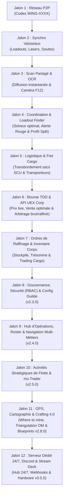

# 🗺️ FEUILLE DE ROUTE OFFICIELLE (ROADMAP) — AARON MFD
## Système d'Exploitation Tactique, Logistique, Commercial & Flotte Multijoueur (*Star Citizen 4.0+*)

> **Version active** : **v2.2.0** (Star Citizen Alpha 4.10) — **Jalons 1, 2, 3, 4, 5, 6 et 7 terminés & déployés** 🚀  
> **Direction stratégique du logiciel** : Élever AARON MFD au rang de **plateforme intégrale de référence pour les opérations industrielles et commerciales de Star Citizen**.
> L'application réunit sous une même interface immersive (mobiGlas) l'ensemble des acteurs d'une opération : **éclaireurs, mineurs, transporteurs lourds, traders de fret, escorteurs de combat et trésoriers de guilde**. Les calculs de puissance et de faisabilité, la synchronisation temps réel des vaisseaux, le partage instantané des scans de rochers, le transbordement de fret en vol, le suivi des ordres de raffinage, la cartographie GPS des filons, l'arbitrage commercial aux TDD, la trésorerie de corporation et la simulation de routes de trading cargo sont orchestrés de manière fluide, 100% autonome et sans aucun serveur payant (P2P Serverless).

---

## 🎯 Vision & Principes Fondamentaux

1. **Zéro Serveur Payant & Souveraineté Totale (Serverless P2P) :**
   * Communication directe de navigateur à navigateur via **WebRTC DataChannels**.
   * Aucune base de données centralisée requise, aucun compte obligatoire, respect absolu de la vie privée.
   * Fonctionnement local résilient : utilisation d'un courtier de signalement gratuit (PeerJS Cloud / STUN Google) avec fallback local `BroadcastChannel` pour les tests multi-écrans sur le même poste ou réseau local.

2. **Chaîne de Valeur Industrielle Complète (Du Laser au TDD) :**
   * **1. Prospection & Scan OCR :** Détection de rochers, lecture optique par caméra / capture F12 et diffusion à la flotte.
   * **2. Fracturation & Extraction :** Puissance cumulée, solveur de loadout optimal (*Optimal Loadout Finder*), régulation thermique, assistance vocale et alertes d'instabilité.
   * **3. Sécurité & Escorte :** Sentinelle radar, bouton d'alerte rouge et prime de protection pour les chasseurs de combat.
   * **4. Logistique & Fret Spécialisé :** Transbordement en vol de sacs miniers / conteneurs SCU vers des cargos dédiés.
   * **5. Raffinage & Inventaire :** Gestionnaire d'ordres de raffinage, minuteries en arrière-plan, notifications push déportées et registre de corporation (*Corpo Mining Reserves*).
   * **6. Commerce, Vente TDD & API UEX Corp :** Analyse des cours du marché en temps réel (intégration API live UEX Corp avec cache hors-ligne), calcul des marges nettes et optimisation des routes de vente de cargaisons mixtes.
   * **7. Localisateur de Minerais & Crafting 4.0 :** Base de données des gisements (*Where to mine*) et suivi des blueprints de fabrication.
   * **8. Intégration Corpo & Matériel :** Webhooks Discord corporatifs automatiques et profils Stream Deck.

3. **Immersion Cockpit Authentique (Style mobiGlas Star Citizen 4.0+) :**
   * Interface sombre néon inspirée des cockpits de vaisseaux, voyants de comms chiffrées, ping en direct, indicatifs radio personnalisés (`CITIZEN-1`, etc.).
   * Synthèse vocale cockpit (TTS) et retours sonores immersifs.

4. **100% Hors-Ligne & Rétro-compatibilité :**
   * L'application reste utilisable à 100% en mode solo hors-ligne (PWA avec cache local).

---

## 🚀 Vue d'Ensemble des Jalons de Développement



---

### 📡 JALON 1 — Couche Réseau P2P & Connexion d'Escadre (*AARON FLEET-NET*) — [TERMINÉ / DISPONIBLE v1.8.0]
*Objectif : Permettre à un groupe de s'interconnecter en moins de 5 secondes sans inscription, en local et à distance via Internet.*

* **Système de Salons Rapides (Room Codes) :**
  * Génération automatique d'un identifiant d'escadre court et mémorisable (ex: `WING-4982` ou `STANTON-DELTA`).
  * Connexion par saisie du code ou via lien d'invitation 1-clic (`https://.../?fleet=WING-4982`).
* **Architecture Réseau Hybride (Internet + Local) :**
  * **WebRTC DataChannels (Internet P2P)** : Canaux de données directs de navigateur à navigateur chiffrés, traversée NAT via serveurs STUN publics (Google STUN) et passerelle PeerJS intégrée localement.
  * **BroadcastChannel (Local)** : Communication instantanée (< 1ms) inter-onglets et multi-écrans sur la même machine.
  * Nœud Hôte (Créateur de l'escadre) et Nœuds Pairs (Ailiers) avec Star-Mesh Relay.
  * Heartbeat / Ping temps réel pour surveiller la latence en millisecondes et la présence des pairs (timeouts > 8s).
* **Interface mobiGlas & MFD :**
  * Panneau dédié FLEET-NET dans la modale d'escouade : indicateur de statut (`SOLO (HORS-LIGNE)`, `CONNECTÉ (AARON FLEET-NET)`), diode pulsante verte.
  * Télémétrie en direct : affichage du ping RTT (`XX ms`) et nombre de pairs en ligne.
  * Voyant radio interactif `COMMS` dans l'en-tête système mobiGlas (`WING-XXXX [X pairs • Xms]`).

---

### 🛸 JALON 2 — Synchronisation Temps Réel des Vaisseaux & Configurations — [TERMINÉ / DISPONIBLE v1.8.0]
*Objectif : Quand un joueur modifie sa configuration, toute l'escadre est actualisée automatiquement.*

* **Diffusion Automatique des Équipements :**
  * **Vaisseau actif :** Prospector, MOLE, Arrastra, Orion, ROC, ROC-DS, vaisseaux cargos (C2, Taurus, RAFT, Freelancer MAX, Zeus CL, Hull).
  * **Armement minier :** Type de laser (Lancet, Helix, Arbor, Impact, Klein), taille (S1 ou S2).
  * **Tourelles actives :** Prise en compte dynamique des tourelles du MOLE (1 solo, 2 duo, 3 trio).
  * **Capacité de soute :** SCU disponible et cumulé de l'escadre.
  * **Identité radio :** Indicatif personnalisé du pilote (ex: `Ghost-Leader`, `Miner-02`).
* **Éditeur de Têtes de Minage & Gadgets Craftés (*Custom & Crafted Mining Heads*) :**
  *(Adapté au système de Crafting Star Citizen 4.0)*
  * **Création et clonage de têtes artisanales :** Les joueurs peuvent créer de nouvelles têtes personnalisées ou modifier les stats de têtes existantes (ex: *Lancet MH1 Tier 3 Craft*, *Helix Overclocké*).
  * **Réglage fin des caractéristiques :**
    * Puissance de fracture brute (Watts).
    * Modificateur de réduction de résistance rocheuse (% de bonus/malus).
    * Modificateur d'atténuation d'instabilité (%).
    * Taille et vitesse de charge de la fenêtre optimale (Optimal Window %).
    * Nombre d'emplacements de sous-modules (1, 2 ou 3 slots).
  * **Créateur de Gadgets Miniers Sur-Mesure :** Ajout de gadgets artisanaux ou prototypes de guilde avec réglages personnalisés des bonus de résistance, instabilité et fenêtre verte.
  * **Persistance & Synchronisation P2P :** Vos têtes et gadgets craftés sont sauvegardés dans votre profil local et automatiquement diffusés à vos coéquipiers lors de la connexion (`FLEET_SYNC`), afin que les calculateurs de toute l'escadre intègrent vos vraies statistiques artisanales.
* **Calculateur de Flotte Dynamique :**
  * Puissance combinée en Watts calculée et mise à jour en direct sur tous les écrans.
  * Réduction globale de résistance cumulée selon les lasers Lancet actifs.
  * Ajustement automatique du nombre de parts dans le module de partage de gains.

---

### 🪨 JALON 3 — Télémétrie de Scan Partagée & Scanner OCR Instantané — [TERMINÉ / DISPONIBLE v1.8.0]
*Objectif : Zéro saisie manuelle et mise à jour instantanée des MFD de la flotte dès qu'un rocher est scanné.*

* **Transmission Instantanée du Scan :**
  * Dès qu'un membre scanne un rocher (clavier, curseurs, voix ou OCR) :
    * Masse (kg), Archétype géologique, Minerais détectés et pourcentages, Résistance et Instabilité.
  * Diffusion en < 150 ms à tous les membres de la flotte.
  * Mise à jour automatique des jauges et calculs de faisabilité sur tous les MFD connectés.
  * Notification visuelle et synthèse vocale cockpit (*"📡 Scan reçu de [Callsign] : Rocher Quantainium 5 200 kg"*).
* **Scanner OCR Instantané (Caméra Smartphone / Capture d'Écran F12) :**
  *(Reconnaissance optique de scan instantanée)*
  * Pointez la caméra vers l'écran ou glissez une capture d'écran du réticule de scan de Star Citizen.
  * Moteur OCR 100% local (exécuté dans le navigateur sans envoyer d'image sur un serveur distant).
  * Extraction automatique en 0,3 seconde de toutes les valeurs et injection directe dans le calculateur.

---

### ⚡ JALON 4 — Coordination Tactique, Solveur Optimal & Escorte — [TERMINÉ / DISPONIBLE v1.9.0]
*Objectif : Coordonner le tir conjoint des lasers, recommander le meilleur loadout et sécuriser la flottille.*

* **Solveur de Loadout Optimal (*Optimal Loadout Finder*) :**
  *(Algorithme prédictif de puissance et résistances)*
  * Pour un rocher donné particulièrement résistant, l'algorithme calcule et suggère immédiatement la configuration exacte de lasers et de modules à équiper (ex: *« Pour cette roche de 8 200 kg à 58% de résistance : Équiper Lancet MH1 + 2x Focus III + 1x Surge »* ou *« Duo requis : 1x Lancet + 1x Helix »*).
* **Optimisation Ergonomique Cockpit & Discord Voice :**
  * Retrait des étapes textuelles de tir conjoint manuelles (doublons avec les communications vocales Discord en vol) pour maximiser la lisibilité du Solveur d'Équipement Optimal 4.0 et de la jauge de fracturation.
* **Module Sentinelle & Escorte de Combat (`RED ALERT`) :**
  * Affichage simplifié pour les pilotes de chasseurs de protection (Gladius, Scorpius, Vanguard, F7C).
  * **Bouton d'Alerte Rouge en 1 tap** : alarme sonore d'attaque pirate envoyée en direct avec vecteur de repli Quantum d'urgence.
  * Prime de protection automatique intégrée dans le partage des gains.

---

### 📦 JALON 5 — Transport Spécialisé & Logistique de Fret (*Cargo Refactor 4.0*) — [TERMINÉ / DISPONIBLE v2.0.0]
*Objectif : Coordonner le transbordement de minerai en plein espace et gérer les soutes des transporteurs lourds.*

* **Flotte de 10 Transporteurs Dédiés Authentiques (Star Citizen 4.0) :**
  * Drake Cutlass Black (46 SCU, rayon S1), Crusader C1 Spirit (64 SCU, rayon S2), MISC Hull A (64 SCU), MISC Freelancer MAX (120 SCU, rayon S1), RSI Zeus Mk II CL (128 SCU, rayon S2).
  * RSI Constellation Taurus (174 SCU, tourelle tractrice S2 ventrale motorisée), Argo RAFT (192 SCU, grue électromagnétique S3 de déchargement rapide), Drake Caterpillar (576 SCU, 2x postes tracteurs de coursive), Crusader C2 Hercules (696 SCU, 2x postes avant/arrière), MISC Hull C (4 608 SCU, arrimage orbital).
  * Spécifications complètes des rayons tracteurs (taille S1/S2/S3, force en Newtons 6 000 à 45 000 N), topologies de grille (interne, externe, modulaire, spindle) et calcul automatique de la capacité max en sacoches Prospector (8 SCU) et MOLE (12 SCU).
* **Transbordement en Vol (Ship-to-Ship Saddlebag Transfer) via FLEET-NET :**
  * Dans Star Citizen Alpha 3.24/4.0+, les sacs de minage (*saddlebags*) du Prospector (4x 8 SCU) et du MOLE (8x 12 SCU) sont détachables au rayon tracteur.
  * **Demande de Récupération (`CARGO_PICKUP_REQUEST`)** : le mineur clique sur `📡 APPELER TRANSPORT DE FRET` ; les transporteurs de l'escadre reçoivent l'alerte en direct avec détails des minerais et volume SCU.
  * **Validation & Prise en Charge (`CARGO_PICKUP_ACCEPT`)** : le transporteur clique sur `🧲 ARRIMAGE RAYON TRACTEUR`, ce qui arrime les sacs sur sa grille physique et vide instantanément la soute du mineur sans retour à la station.
* **Gestionnaire Visuel de Soute (Cargo Grid Master) :**
  * Carte cockpit interactive `#cargoGridMasterCard` : sélecteur de transporteur actif, jauge de remplissage physique, visualisation des blocs de conteneurs arrimés par minerai, badge d'avertissement d'instabilité du Quantainium brut, estimation financière en temps réel (brut & raffiné) et bouton de déchargement au terminal.
* **Commission Transporteur Dédiée :**
  * Curseur de commission de fret (0 à 35%) intégré dans la répartition des gains d'escouade (`#crewModal`), permettant une rémunération équitable des pilotes de transport lourd.

---

### 📈 JALON 6 — Bourse Commerciale, API UEX Corp & Intelligence de Guilde [TERMINÉ / DISPONIBLE v2.1.0]
*Objectif : Maximiser les bénéfices financiers grâce aux cours du marché en direct, au partage collaboratif au sein de la corporation et à l'optimisation des trajets.*

* **Intégration API Live UEX Corp (*Live Price Integration*) :**
  *(Données de marché en temps réel)*
  * Connexion transparente à l'API publique UEX Corp (`uexcorp.space`) pour récupérer les cours réels d'achat et de vente des minerais dans tous les terminaux TDD et stations de Stanton et Pyro.
  * **Cache local hors-ligne (`price_cache`)** : si la connexion Internet est coupée en vol, le MFD bascule automatiquement sur les derniers prix mis en cache sans bloquer l'interface.
* **Crowdsourcing & Intelligence des Prix de Guilde (*Corpo Price Scouts*) :**
  *(Innovation exclusive AARON MFD)*
  * **Mise à jour collaborative en 1 tap** : Lorsqu'un membre de la guilde se pose à un terminal TDD, une raffinerie ou un avant-poste de Pyro et constate les cours réels, les frais ou la demande disponible, il valide ou ajuste le prix sur son MFD.
  * **Diffusion instantanée à toute la guilde** : En moins de 150 ms, un paquet `CORPO_PRICE_UPDATE` est répercuté sur les MFD de tous les membres de la guilde avec la mention : *"Prix actualisé par [Callsign] il y a 2 min"*.
* **Moteur d'Arbitrage Économique (Brut vs Raffiné) :**
  * Calcul en temps réel du gain net après déduction des frais de raffinage, de carburant et de manutention cargo.
  * Recommandation de la méthode optimale (*Dinyx, Cormack, Ferron, Gencore*).
* **Calculateur de Vente Globale de Stock (*Best Sales Locations Optimizer*) :**
  * L'application analyse l'ensemble des stocks de votre guilde et calcule le plan de tournée commercial optimal pour maximiser les aUEC en un minimum de sauts Quantum, sans saturer la demande des terminaux TDD.

---

### ⏱️ JALON 7 — Ordres de Raffinage & Inventaire Partagé de Guilde (✅ Implémenté v2.2.0) — Trésorerie & Trading Cargo
*Objectif : Suivre le portefeuille d'actifs miniers individuel, mutualiser les stocks de fret (minerais + marchandises générales), gérer la trésorerie corporative et simuler les runs de trading cargo.*

* **Inventaire Collaboratif & Stockpile Unifié de Guilde (*Guild Shared Stockpile*) :**
  *(Innovation exclusive AARON MFD — Minerais & Marchandises Générales)*
  * **Inventaire de guilde partagé en temps réel** : Chaque fois qu'un mineur dépose du minerai en raffinerie ou qu'un transporteur stocke des caisses SCU de minerais ou de marchandises générales (Medical Supplies, Laranite, Titanium, Scrap, Distilled Spirits, Maze, Slam, etc.) dans un hangar, l'inventaire est synchronisé sur les MFD de toute la corporation (`CORPO_STOCK_SYNC`).
  * **Visibilité logistique totale** : N'importe quel membre ou responsable logistique voit en direct les réserves globales :  
    *Exemple : « ARC-L1 : 256 SCU Quantainium raffiné » • « Orison : 576 SCU Medical Supplies (Coût 16.5 aUEC, Revente 24.2 aUEC, Marge +4,435k aUEC) »*.
  * **Badges distinctifs** : Différenciation visuelle instantanée `⛏️ MINERAI` et `📦 COMMODITY` avec prix d'achat unitaire, valeur estimée de revente et marge brute.
  * Calcul en direct de la **valeur nette totale du patrimoine de la guilde (Guild Net Worth en aUEC)** déduite des dépenses.
* **Gestionnaire d'Ordres de Raffinage & Notifications Push :**
  * **Statut logistique allégé** : Évite les doublons avec les consoles de jeu en proposant un statut clair (*Brut stocké, En cours de raffinage, Raffiné prêt au transport*).
  * Minuteur dynamique et décompte précis (heures/minutes) pour chaque ordre de raffinage en cours.
  * **Notifications Web Push déportées** sur smartphone ou PC (même navigateur fermé) :  
    `🔔 Raffinerie ARC-L1 : Votre commande de 64 SCU de Quantainium est prête au chargement !`
* **Trésorerie de Guilde & Grand Livre des Dépenses (*Guild Treasury & Expense Ledger*) :**
  * Solde de trésorerie de guilde persistant et synchronisé via `CORPO_TREASURY_SYNC`.
  * Centralisation des dépenses engagées (frais de raffinage, carburant, réparations, consommables, avances cargo) synchronisées via `CORPO_EXPENSE_SYNC`.
  * Dépôts de capitaux, retraits de trésorerie et export du grand livre officiel formaté pour Discord.
* **Feuille de Répartition mo.Trader & Dividendes de Guilde (*Crew Split Sheet*) :**
  * Répartition automatisée des gains d'opération : part de trésorerie corporative retenue à la source (0 à 50%), prime d'escorte de combat, commission de transport lourd, et solde net versé aux équipages.
  * Ordres de virement direct `mo.Trader` copiables en 1 clic pour exécution immédiate dans l'application mobiGlas du jeu.
* **Simulateur de Trading & Routes Cargo (*Commodity Trading & Arbitrage*) :**
  * Sélection de marchandises générales classées par catégorie (Médical, Métaux, Industriel, Consommables, Illicite / Vice).
  * Préréglages de routes commerciales populaires de Stanton & Pyro (ex: Deakins vers Orison, Arial vers Area18, Brio's Breaker Yard, Checkmate, etc.).
  * Préréglages de capacité de soute pour tous les cargos (Cutlass Black 46 SCU jusqu'au C2 Hercules 696 SCU).
  * Calcul en direct du capital requis (aUEC), bénéfice net du run, marge par SCU, retour sur investissement (% ROI) et indice de risque pirate (Sûr, Modéré, Extrême).
  * **Financement direct sur la Trésorerie de Guilde** : Prélèvement automatique du capital requis comme avance de trésorerie avec enregistrement comptable au grand livre.
  * **Dépôt 1-clic en Stockpile de Guilde** : Intégration immédiate de la cargaison achetée dans l'inventaire partagé avec synchronisation de flotte `CORPO_TRADE_SYNC`.

---

### 🔐 JALON 8 — Gouvernance, Sécurité (RBAC) & Configuration de Guilde (v2.3.0)
*Objectif : Poser les fondations de l'organisation : authentification chiffrée, gestion des permissions par rôle, profil corporatif et passerelle Discord.*

* **Architecture Hybride Décentralisée (Phase 1 Local ➔ Phase 2 Serveur 24/7) :**
  * **Phase 1 (Local Immédiat — Souverain & 0€ de serveur)** :
    * Authentification locale sécurisée par mot de passe / clé de guilde et dérivation cryptographique locale (PBKDF2 / WebCrypto).
    * Persistance chiffrée dans le navigateur (`IndexedDB` / `localStorage`).
    * Synchronisation instantanée des paramètres de guilde et des droits via le réseau P2P WebRTC DataChannel (*AARON FLEET-NET*).
  * **Phase 2 (Évolution Serveur Dédié 24/7)** :
    * Passerelle API backend légère (`server.js` Node/Express ou connecteur cloud gratuit Supabase/PostgreSQL) pour persistance 24/7 sans dépendre de l'ordinateur de l'hôte.
* **Système de Permissions & Rôles Hiérarchiques (RBAC - Role-Based Access Control) :**
  * Connexion membre par mot de passe / code de guilde avec attribution de rôle :
    * 👑 **Amirauté / Commandement** : Création/suppression d'opérations, accès total à la trésorerie de guilde, validation des comptes finaux et gestion des autorisations.
    * 📋 **Chefs d'Opérations (Flight Leads)** : Planification des missions, assignation des postes de vol, supervision de la flotte et validation du rapport de mission.
    * 💰 **Trésoriers & Logisticiens Fret** : Approbation des avances financières de trading, gestion du stockpile et enregistrement des frais logistiques.
    * 🚀 **Membres Actifs (Pilotes Industriels & Escorte)** : Inscription aux opérations, déclaration de vaisseau actif, prise en charge de lots de fret et participation aux dividendes.
    * 🔰 **Recrues & Invités** : Accès en consultation, participation aux opérations sous supervision d'un officier.
* **Panneau de Configuration & Administration de Guilde (*Guild Settings & Security Deck*) :**
  * 🏷️ **Identité & Profil Corporation** : Nom officiel de la guilde, tag court/ticker (ex: `[CORP]`), logo, système d'attache (Stanton/Pyro), station QG de ralliement principale (ex: *ARC-L1 Wide Forest Station*) et message du jour de l'Amirauté (MoTD).
  * 🔑 **Sécurité, Mots de Passe & Passphrases** : Configuration du mot de passe Maître (Amirauté), code d'accès Officiers et code d'invitation Membres/Recrues. Dérivation cryptographique locale (WebCrypto) et bascule transparente vers le serveur dédié 24/7.
  * ⚖️ **Politique Financière par Défaut** : Taux par défaut de retenue corporative sur les ventes (ex: 10% à 20%), grille tarifaire des primes d'escorte de combat, barème des commissions transporteurs et seuil d'alerte de réserve minimale de trésorerie.
  * 👥 **Registre des Membres & Attribution des Rôles** : Liste des pilotes enregistrés, promotion/rétrogradation de rangs (RBAC), gestion des indicatifs radio (Callsigns) et révocation d'accès en 1 clic.
  * 💾 **Souveraineté des Données & Sauvegardes** : Export 1-clic de la base de données guilde complète en fichier JSON chiffré (membres, stocks, trésorerie, historique d'opérations) et restauration instantanée sur tout nouvel appareil ou serveur.
* **Passerelle Discord & Widget de Présence en Direct :**
  * Configuration de l'identifiant Discord Server ID pour afficher en temps réel dans AARON MFD les membres connectés et les salons vocaux actifs.
  * Bouton permanent `💬 DISCORD OFFICIEL` pour intégrer les recrues et invités en 1 clic.

---

### 📋 JALON 9 — Hub d'Opérations, Roster de Flotte & Navigation Multi-Spécialités (v2.4.0)
*Objectif : Coordonner la mobilisation de flotte avec une ergonomie optimisée par métier, sans surcharge visuelle.*

* **Navigation Ergonomique à Double Niveau (Onglets Croisés Opérations × Spécialités) :**
  * **Niveau 1 (Sélecteur d'Opérations)** : Barre supérieure permettant de basculer instantanément entre le Hub Global (`🌐 Toutes les Ops`), les opérations actives en direct (`⛏️ OP-STANTON-HARVEST 🟢`), les opérations planifiées (`🚜 CONVOI-PYRO ⏳`) et le créateur de mission (`➕ Nouvelle Opération`).
  * **Niveau 2 (Postes de Travail par Spécialité au sein de l'Opération)** :
    * 📊 **Briefing & Roster** : Objectifs collectifs (SCU / aUEC), jauge d'avancement live, liste des inscrits et assignations de flotte.
    * ⛏️ **Minage & Extraction** : Scans partagés Fleet-Net, solveur de loadout optimal, alerte d'instabilité Quantainium et appel transport 1-clic.
    * 🚜 **Fret & Logistique** : Grilles physiques SCU (Cargo Grid Master), transbordement en vol, stocks raffinés en stations et trajets de déchargement.
    * 📈 **Trading & Arbitrage Cargo** : Simulateur de run, capital requis, avances de trésorerie et surveillance des cours TDD UEX Corp.
    * 🛡️ **Sécurité & Escorte** : Alerte Rouge pirate instantanée, radar sentinelle, vecteurs de repli Quantum d'urgence et prime horaire de combat.
    * 💰 **Comptabilité & mo.Trader (Officiers)** : Grand livre des frais réels engagés, déduction des avances et de la part de guilde, bordereau de virement `mo.Trader` 1-clic.
  * **Aiguillage Automatique par Rôle (*Smart Role Switch*)** : À l'inscription, le membre qui s'enregistre comme Transporteur est automatiquement dirigé vers l'onglet Fret, le pilote de chasse vers l'onglet Sécurité, et le mineur vers l'onglet Minage, avec liberté de naviguer entre tous les onglets.
* **Gestionnaire d'Opérations & Missions de Flotte (*Guild Operations Dispatch*) :**
  * Création de missions typées avec nom de code officiel (ex: *OP-STANTON-HARVEST*, *OPERATION SILENT-RUNNER*) :
    * ⛏️ **Extraction Minière** (Objectifs en SCU, ciblage filons Quantainium/Bexalite).
    * 🚜 **Convois Logistiques de Fret** (Transport sécurisé de raffinats inter-stations).
    * 📈 **Trading & Runs Cargo** (Achat de commodités financé par la trésorerie).
    * 🔧 **Récupération / Salvage** (Opérations de recyclage Reclaimer/Vulture).
    * 🛡️ **Escorte Armée & Patrouilles de Sécurité** (Sécurisation des zones à risque de Pyro).
  * Fiche d'opération détaillée : Date/heure, système stellaire (Stanton/Pyro/Nyx), point de rassemblement, avance budgétaire allouée, pourcentage de retenue corpo pour la caisse commune (ex: 10-20%).
* **Roster de Flotte & Inscription Interactive des Membres :**
  * Module de réponse 1-clic pour les membres : sélection de son rôle tactique et déclaration de son vaisseau mobilisé (MOLE, Prospector, C2, Taurus, Gladius, etc.).
  * **Jauge globale de mobilisation de flotte en direct** : calcul automatique de la capacité cargo cumulée mobilisée (SCU), de la puissance laser globale (Watts) et du nombre de chasseurs d'escorte assignés.
* **Diffusion 1-Clic de Missions vers Discord avec Deep Links (`#annonces-missions`) :**
  * Génération d'un Embed Discord riche aux couleurs de la mission avec objectifs, rôles recherchés et conditions financières.
  * **Lien d'Inscription Direct 1-Clic (*Deep Linking*)** : URL personnalisée (`https://.../?op=OP-HARVEST-12`) ouvrant instantanément AARON MFD sur l'opération pour déclarer son vaisseau et son rôle en 2 secondes depuis un smartphone ou un PC.

---

### ⚔️ JALON 10 — Activités Stratégiques de Flotte, Assurance & Clôture mo.Trader (v2.5.0)
*Objectif : Piloter les grandes activités d'organisation, sécuriser le matériel et automatiser la redistribution des richesses.*

* **Tableau de Bord Stratégique du Chef de Guilde (*Fleet Commander Strategic Deck*) :**
  *(Les 6 grands types d'activités à haute valeur opérationnelle pilotés par l'Amirauté et les Flight Leads)* :
  1. ⛏️ **Campagnes d'Extraction en Essaim (*Industrial Swarm Operations*)** : Jauge d'objectif global en SCU/aUEC, gestion de la tournante logistique des navettes cargo (*Shuttle Runs*), suivi de la saturation en sacoches larguées en plein espace et sélection de la raffinerie au meilleur rendement selon l'horaire de fin de session.
  2. 🚜 **Convois Sécurisés & Traversées Hostiles (Stanton ➔ Pyro)** : Calculateur de ratio de menace basé sur la valeur totale transportée, dimensionnement automatique de l'escorte requise (chasseurs/SCU), plan de vol à sauts décalés (éclaireur à 1 saut d'avance) et déclenchement d'Alerte Rouge coordonnée.
  3. 📈 **Arbitrage Spéculatif & Caisse de Guerre (*War Chest Trading*)** : Avances de trésorerie de guilde débloquées pour runs de fret massifs à fort effet de levier (ex: 2.5M aUEC financés pour remplir un C2 de Medical Supplies / Laranite), détection d'opportunités de revente TDD et prélèvement d'un dividende corporatif pour alimenter le fonds de réserve.
  4. 🔧 **Grands Chantiers d'Artisanat 4.0 (*Corpo Blueprint Wishlists*)** : Lancement de projets de fabrication collective (ex: équiper les MOLE de l'organisation en têtes laser artisanales Tier 3), ventilation automatique des minerais requis, barres de progression partagées et système de points de contribution pour les mineurs déposants avec mise à jour automatique Discord (`#besoins-crafting`).
  5. 🧲 **Chantiers de Salvage & Pillage d'Épaves (*Wreck Recovery Ops*)** : Moisson coordonnée de RMC (*Recycled Material Composite*) et *Construction Materials* (CM) par Reclaimers/Vultures, et registre des composants militaires de valeur récupérés (boucliers Grade A, armes S5) pour réarmer la flotte de combat de la guilde.
  6. 🛡️ **Caisse d'Assurance de Flotte & Primes de Combat (*Fleet Insurance & Loss Compensation*)** : Déclaration d'incident en 1 clic (chasseur d'escorte abattu ou cargaison perdue), indemnisation prioritaire des pertes matérielles sur la trésorerie commune avant le calcul du profit net des survivants.
* **Conduite Temps Réel de Mission & Alertes Logistiques :**
  * Cycle de vie dynamique : `PLANIFIÉE` ➔ `EN COURS (LIVE)` ➔ `DÉBRIEFING` ➔ `CLÔTURÉE`.
  * Agrégation continue des dépenses engagées (carburant, réarmement, raffinage) et des recettes de vente.
  * Notifications automatiques dans Discord (`#logistique-fret`) dès que des sacs miniers sont largués en plein espace ou que des lots raffinés sont prêts au déchargement pour les transporteurs C2/Taurus.
* **Clôture Financière Automatisée & Bordereaux mo.Trader 1-Clic :**
  * Déduction automatique de l'avance de trésorerie, remboursement des frais réels et prélèvement de la réserve de guilde.
  * Génération de la **Feuille de Virement `mo.Trader`** : bordereau officiel avec ordres de transfert individuels copiables en 1 clic pour exécution immédiate dans le mobiGlas du jeu.
  * Publication officielle du bilan de clôture sur Discord (`#comptabilité-tresorerie`).

---

### 📍 JALON 11 — Cartographie "Where to Mine", GPS & Crafting 4.0 (v2.8.0)
*Objectif : Savoir où trouver chaque minerai, marquer ses gisements et suivre ses besoins de fabrication.*

* **Guide des Gisements & Probabilités (*Resource Location Data / Where to Mine*) :**
  *(Cartographie géologique & astéroïdes)*
  * Base de données complète des lieux de prospection de Stanton et Pyro : où trouver en priorité du Quantainium, de la Bexalite, de la Taranite ou de l'Hadanite (ceintures d'astéroïdes, lunes, taux d'apparition et densité moyenne).
* **Calculateur de Triangulation Orbitale & Carnet de Waypoints :**
  * Saisie rapide des distances aux balises orbitales (OM-1 à OM-6) ou stations pour retrouver un amas riche après déchargement.
  * Envoi d'une balise de gisement en direct aux membres de l'escadre via le réseau P2P.
* **Suivi des Blueprints & Crafting 4.0 (*Blueprint & Material Tracking*) :**
  *(Planification et artisanat d'équipements)*
  * Dans Star Citizen 4.0, la fabrication de composants, armures et surtout **de têtes de minage et gadgets supérieurs** nécessite des minerais spécifiques.
  * Créez une « Liste de souhaits » de matériaux (ex: *« Besoin de 45 SCU de Titane et 15 SCU de Béryl pour crafter ma tête Lancet Custom Mk II »*) avec barre de progression qui se remplit automatiquement lors de vos sessions de minage.
  * **Simulateur de Gain d'Artisanat (*Crafting ROI Simulator*)** : Évaluez en amont si fabriquer une tête craftée supérieure permet de franchir de nouveaux seuils de fracture sur les rochers de haute résistance sans consommer de consommables/gadgets coûteux.

---

### 🤖 JALON 12 — Écosystème Serveur Dédié 24/7, Discord & Hardware Stream Deck (v3.0.0)
*Objectif : Faciliter le partage corporatif, la persistance 24/7 sur serveur et l'utilisation physique à côté des joysticks HOTAS.*

* **Mode Serveur Dédié 24/7 & Synchronisation Permanente :**
  * Possibilité de déployer AARON MFD sur un serveur Linux/Docker ou cloud pour offrir à toute la corporation un hub permanent accessible même machine locale éteinte.
* **Intégration Webhook Discord Automatique (Corpo Dispatch) :**
  * Configuration simple de l'URL Webhook Discord de la corporation.
  * À la clôture d'une opération ou d'une vente TDD, génération automatique d'un rapport officiel richement formaté avec visuels :
    * Vaisseaux et équipages mobilisés.
    * Quantités de minerais extraits, transportés et vendus.
    * Chiffre d'affaires brut, frais déduits et solde net versé à chaque pilote.
    * Contribution créditée à la trésorerie de guilde.
* **Intégration Matérielle & Stream Deck (Hardware Interlink) :**
  * Profils Stream Deck prêts à l'emploi et raccourcis clavier globaux :
    * Déclenchement du compte à rebours Quantainium 15 min.
    * Touche de diffusion instantanée du scan actuel à la flotte.
    * Touche de transbordement / largage rapide de sacs miniers.
    * Bascule d'équipage et validation de soute.

---

## 🛠️ Spécifications des Paquets Télémétriques (WebRTC JSON Specs)

Les messages échangés via WebRTC DataChannels sont au format JSON ultra-léger (< 1 Ko) :

```json
// 1. FLEET_SYNC : Mise à jour de vaisseau
{
  "type": "FLEET_SYNC",
  "senderId": "peer_8f7b2c",
  "callsign": "VORTEX-1",
  "loadout": {
    "shipId": "mole",
    "role": "mining",
    "activeTurrets": 2,
    "lasers": ["lancet_s2", "helix_s2"],
    "cargoSCU": 96
  }
}

// 2. ROCK_BROADCAST : Diffusion d'un scan rocheux (Manuel ou OCR)
{
  "type": "ROCK_BROADCAST",
  "senderId": "peer_8f7b2c",
  "callsign": "SCOUT-LEADER",
  "rock": {
    "mass": 5800,
    "mineralId": "quantainium",
    "orePercentage": 34.5,
    "archetypeId": "asteroid_c",
    "resistance": 42,
    "instability": 58,
    "estimatedValue": 1740000
  }
}

// 3. PICKUP_REQUEST : Demande de transbordement de sacs en vol
{
  "type": "PICKUP_REQUEST",
  "senderId": "peer_8f7b2c",
  "callsign": "MINER-PROSPECTOR",
  "pickup": {
    "location": "Aaron Halo Band 5",
    "totalSCU": 32,
    "minerals": [{ "id": "quantainium", "scu": 24.5 }, { "id": "bexalite", "scu": 7.5 }]
  }
}

// 4. RED_ALERT : Alerte détresse / pirate pour l'escorte
{
  "type": "RED_ALERT",
  "senderId": "peer_8f7b2c",
  "callsign": "MINER-PROSPECTOR",
  "alert": {
    "status": "under_attack",
    "hostileCount": 2,
    "emergencyVector": "Jump HUR-L3"
  }
}

// 5. CORPO_PRICE_UPDATE : Mise à jour collaborative des prix du marché
{
  "type": "CORPO_PRICE_UPDATE",
  "senderId": "peer_9a2f1b",
  "callsign": "SCOUT-MERCHANT",
  "terminal": "New Babbage TDD (microTech)",
  "mineralId": "quantainium",
  "commodityType": "refined",
  "verifiedPrice": 268.5,
  "demandLevel": "high",
  "timestamp": 1729000015000
}

// 6. CORPO_STOCK_SYNC : Synchronisation des stocks & Inventaire de guilde
{
  "type": "CORPO_STOCK_SYNC",
  "senderId": "peer_8f7b2c",
  "callsign": "MINER-PROSPECTOR",
  "action": "deposit",
  "location": "ARC-L1 Wide Forest Station",
  "minerals": [
    { "mineralId": "quantainium", "scu": 32.0, "status": "refining_dinyx", "etaMinutes": 840 },
    { "mineralId": "bexalite", "scu": 16.0, "status": "refined_ready" }
  ],
  "timestamp": 1729000020000
}
```

---

## 📋 Matrice des Fonctionnalités par Version

| Fonctionnalité | v1.6.4 (Base) | v1.8.0 (Jalons 1, 2 & 3) | v1.9.0 (Jalon 4) | v2.0.0 (Jalon 5) | v2.1.0 (Jalon 6) | v2.2.0 (Actuel - Jalon 7) | v2.3.0 (Jalon 8) | v2.4.0 (Jalon 9) | v2.5.0 (Jalon 10) | v2.8.0 (Jalon 11) | v3.0.0 (Jalon 12) |
| :--- | :---: | :---: | :---: | :---: | :---: | :---: | :---: | :---: | :---: | :---: | :---: |
| Calculateur Solo Tactique & PWA Offline | ✅ | ✅ | ✅ | ✅ | ✅ | ✅ | ✅ | ✅ | ✅ | ✅ | ✅ |
| Simulation Multi-Tourelles MOLE / Arrastra / Orion | ✅ | ✅ | ✅ | ✅ | ✅ | ✅ | ✅ | ✅ | ✅ | ✅ | ✅ |
| Connexion P2P WebRTC & Local (*FLEET-NET*) | ❌ | ✅ | ✅ | ✅ | ✅ | ✅ | ✅ | ✅ | ✅ | ✅ | ✅ |
| Synchronisation Auto des Vaisseaux & Loadouts | ❌ | ✅ | ✅ | ✅ | ✅ | ✅ | ✅ | ✅ | ✅ | ✅ | ✅ |
| Atelier Minier Artisanal (*Crafting 4.0*) | ❌ | ✅ | ✅ | ✅ | ✅ | ✅ | ✅ | ✅ | ✅ | ✅ | ✅ |
| Diffusion P2P des Scans de Roches (*ROCK_BROADCAST*) | ❌ | ✅ | ✅ | ✅ | ✅ | ✅ | ✅ | ✅ | ✅ | ✅ | ✅ |
| Scanner OCR Instantané (*F12, Caméra & Presets*) | ❌ | ✅ | ✅ | ✅ | ✅ | ✅ | ✅ | ✅ | ✅ | ✅ | ✅ |
| Solveur de Loadout Optimal 4.0 (*Solo & Escadre*) | ❌ | ❌ | ✅ | ✅ | ✅ | ✅ | ✅ | ✅ | ✅ | ✅ | ✅ |
| Module Sentinelle & Alerte Rouge Escorte (*RED ALERT*) | ❌ | ❌ | ✅ | ✅ | ✅ | ✅ | ✅ | ✅ | ✅ | ✅ | ✅ |
| Prime de Risque d'Escorte de Combat (*Crew Split*) | ❌ | ❌ | ✅ | ✅ | ✅ | ✅ | ✅ | ✅ | ✅ | ✅ | ✅ |
| Flotte de Transporteurs 4.0 Authentique (10 vaisseaux) | ❌ | ❌ | ❌ | ✅ | ✅ | ✅ | ✅ | ✅ | ✅ | ✅ | ✅ |
| Transbordement en Vol & Sacs Détachables SCU (*Fleet-Net*) | ❌ | ❌ | ❌ | ✅ | ✅ | ✅ | ✅ | ✅ | ✅ | ✅ | ✅ |
| Gestionnaire Visuel de Soute Cargo 4.0 (*Tractor Beam*) | ❌ | ❌ | ❌ | ✅ | ✅ | ✅ | ✅ | ✅ | ✅ | ✅ | ✅ |
| Commission Transporteur Dédiée (*Crew Split*) | ❌ | ❌ | ❌ | ✅ | ✅ | ✅ | ✅ | ✅ | ✅ | ✅ | ✅ |
| Bourse Commerciale Live & API UEX Corp | ❌ | ❌ | ❌ | ❌ | ✅ | ✅ | ✅ | ✅ | ✅ | ✅ | ✅ |
| Optimiseur de Ventes & Arbitrage Brut/Raffiné | ❌ | ❌ | ❌ | ❌ | ✅ | ✅ | ✅ | ✅ | ✅ | ✅ | ✅ |
| Suivi Raffinage & Notifications Push | ❌ | ❌ | ❌ | ❌ | ❌ | ✅ | ✅ | ✅ | ✅ | ✅ | ✅ |
| Portefeuille Minier, Stocks & Trésorerie Guilde | ❌ | ❌ | ❌ | ❌ | ❌ | ✅ | ✅ | ✅ | ✅ | ✅ | ✅ |
| Simulateur de Trading & Arbitrage Cargo | ❌ | ❌ | ❌ | ❌ | ❌ | ✅ | ✅ | ✅ | ✅ | ✅ | ✅ |
| Authentification Guilde & Permissions Rôles (RBAC) | ❌ | ❌ | ❌ | ❌ | ❌ | ❌ | 🚀 Prévu | ✅ | ✅ | ✅ | ✅ |
| Panneau de Configuration & Administration Guilde | ❌ | ❌ | ❌ | ❌ | ❌ | ❌ | 🚀 Prévu | ✅ | ✅ | ✅ | ✅ |
| Passerelle Discord (Widget Présence Live) | ❌ | ❌ | ❌ | ❌ | ❌ | ❌ | 🚀 Prévu | ✅ | ✅ | ✅ | ✅ |
| Architecture Hybride (Local P2P ➔ Serveur Dédié) | ❌ | ❌ | ❌ | ❌ | ❌ | ❌ | 🚀 Prévu | ✅ | ✅ | ✅ | ✅ |
| Gestionnaire d'Opérations (Minage, Fret, Trading) | ❌ | ❌ | ❌ | ❌ | ❌ | ❌ | ❌ | 🚀 Prévu | ✅ | ✅ | ✅ |
| Navigation Ergonomique Multi-Spécialités | ❌ | ❌ | ❌ | ❌ | ❌ | ❌ | ❌ | 🚀 Prévu | ✅ | ✅ | ✅ |
| Inscription Membres Roster & Mobilisation Flotte | ❌ | ❌ | ❌ | ❌ | ❌ | ❌ | ❌ | 🚀 Prévu | ✅ | ✅ | ✅ |
| Diffusion Missions Discord & Deep Links (?op=XXX) | ❌ | ❌ | ❌ | ❌ | ❌ | ❌ | ❌ | 🚀 Prévu | ✅ | ✅ | ✅ |
| Activités Stratégiques Flotte (Essaim, Convois, Caisse) | ❌ | ❌ | ❌ | ❌ | ❌ | ❌ | ❌ | ❌ | 🚀 Prévu | ✅ | ✅ |
| Caisse d'Assurance Flotte & Pertes Matérielles | ❌ | ❌ | ❌ | ❌ | ❌ | ❌ | ❌ | ❌ | 🚀 Prévu | ✅ | ✅ |
| Suivi Temps Réel de Mission & Alertes Logistiques | ❌ | ❌ | ❌ | ❌ | ❌ | ❌ | ❌ | ❌ | 🚀 Prévu | ✅ | ✅ |
| Clôture Financière Automatisée & Bordereau mo.Trader | ❌ | ❌ | ❌ | ❌ | ❌ | ❌ | ❌ | ❌ | 🚀 Prévu | ✅ | ✅ |
| Guide "Where to Mine", GPS & Blueprints | ❌ | ❌ | ❌ | ❌ | ❌ | ❌ | ❌ | ❌ | ❌ | 🚀 Prévu | ✅ |
| Mode Serveur Dédié 24/7 & Webhooks Discord | ❌ | ❌ | ❌ | ❌ | ❌ | ❌ | ❌ | ❌ | ❌ | ❌ | 🚀 Prévu |
| Intégration Stream Deck / Hardware | ❌ | ❌ | ❌ | ❌ | ❌ | ❌ | ❌ | ❌ | ❌ | ❌ | 🚀 Prévu |

---

## 📌 Conclusion & Prochaines Étapes

Cette feuille de route officielle trace la trajectoire d'AARON MFD vers le statut d'application compagnon ultime pour Star Citizen. L'implémentation suivra rigoureusement cet ordonnancement, garantissant à chaque version une stabilité irréprochable et une valeur opérationnelle maximale pour les pilotes.
