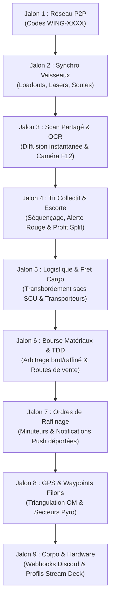

# 🗺️ FEUILLE DE ROUTE OFFICIELLE (ROADMAP) — AARON MFD
## Système d'Exploitation Tactique, Logistique, Commercial & Flotte Multijoueur (*Star Citizen 4.0+*)

> **Direction stratégique du logiciel** : Élever AARON MFD au rang de **plateforme intégrale pour les opérations industrielles de Star Citizen**.
> L'application réunit sous une même interface immersive (mobiGlas) l'ensemble des acteurs d'une opération : **éclaireurs, mineurs, transporteurs lourds, escorteurs de combat et gestionnaires de corporation**. Les calculs de puissance et de faisabilité, la synchronisation temps réel des vaisseaux, le partage instantané des scans de rochers, le transbordement de fret en vol, le suivi des ordres de raffinage, la cartographie GPS des filons et l'arbitrage commercial aux TDD sont orchestrés de manière fluide, 100% autonome et sans aucun serveur payant (P2P Serverless).

---

## 🎯 Vision & Principes Fondamentaux

1. **Zéro Serveur Payant & Souveraineté Totale (Serverless P2P) :**
   * Communication directe de navigateur à navigateur via **WebRTC DataChannels**.
   * Aucune base de données centralisée requise, aucun compte obligatoire, respect absolu de la vie privée.
   * Fonctionnement local résilient : utilisation d'un courtier de signalement gratuit (PeerJS Cloud / STUN Google) avec fallback local `BroadcastChannel` pour les tests multi-écrans sur le même poste ou réseau local.

2. **Chaîne de Valeur Industrielle Complète (Du Laser au TDD) :**
   * **1. Prospection & Scan OCR :** Détection de rochers, lecture optique par caméra / capture F12 et diffusion à la flotte.
   * **2. Fracturation & Extraction :** Puissance cumulée, régulation thermique, assistance vocale et alertes d'instabilité.
   * **3. Sécurité & Escorte :** Sentinelle radar, bouton d'alerte rouge et prime de protection pour les chasseurs de combat.
   * **4. Logistique & Fret Spécialisé :** Transbordement en vol de sacs miniers / conteneurs SCU vers des cargos dédiés.
   * **5. Raffinage Industriel :** Gestionnaire d'ordres de raffinage, minuteries en arrière-plan et notifications push déportées.
   * **6. Commerce & Vente TDD :** Analyse des cours du marché de Stanton et Pyro, calcul des marges nettes et arbitrage commercial.
   * **7. Intégration Corpo & Matériel :** Webhooks Discord corporatifs automatiques et profils Stream Deck.

3. **Immersion Cockpit Authentique (Style mobiGlas Star Citizen 4.0+) :**
   * Interface sombre néon inspirée des cockpits de vaisseaux, voyants de comms chiffrées, ping en direct, indicatifs radio personnalisés (`CITIZEN-1`, etc.).
   * Synthèse vocale cockpit (TTS) et retours sonores immersifs.

4. **100% Hors-Ligne & Rétro-compatibilité :**
   * L'application reste utilisable à 100% en mode solo hors-ligne (PWA).

---

## 🚀 Vue d'Ensemble des Jalons de Développement



---

### 📡 JALON 1 — Couche Réseau P2P & Connexion d'Escadre (*AARON FLEET-NET*)
*Objectif : Permettre à un groupe de s'interconnecter en moins de 5 secondes sans inscription.*

* **Système de Salons Rapides (Room Codes) :**
  * Génération automatique d'un identifiant d'escadre court et mémorisable (ex: `WING-4982` ou `STANTON-DELTA`).
  * Connexion par saisie du code ou via lien d'invitation 1-clic (`https://.../?fleet=WING-4982`).
* **Architecture Réseau :**
  * Nœud Hôte (Créateur de l'escadre) et Nœuds Pairs (Équipiers).
  * Heartbeat / Ping temps réel pour surveiller la latence et la présence des pairs.
* **Interface mobiGlas :**
  * Panneau dédié dans la modale d'escouade : indicateur de statut (`DÉCONNECTÉ`, `RECHERCHE...`, `EN LIGNE [X pairs]`).
  * Voyant radio dans l'en-tête système mobiGlas.

---

### 🛸 JALON 2 — Synchronisation Temps Réel des Vaisseaux & Configurations
*Objectif : Quand un joueur modifie sa configuration, toute l'escadre est actualisée automatiquement.*

* **Diffusion Automatique des Équipements :**
  * **Vaisseau actif :** Prospector, MOLE, Arrastra, Orion, ROC, ROC-DS, vaisseaux cargos (C2, Taurus, RAFT, Freelancer MAX, Zeus CL, Hull).
  * **Armement minier :** Type de laser (Lancet, Helix, Arbor, Impact, Klein), taille (S1 ou S2).
  * **Tourelles actives :** Prise en compte dynamique des tourelles du MOLE (1 solo, 2 duo, 3 trio).
  * **Capacité de soute :** SCU disponible et cumulé de l'escadre.
  * **Identité radio :** Indicatif personnalisé du pilote (ex: `Ghost-Leader`, `Miner-02`).
* **Calculateur de Flotte Dynamique :**
  * Puissance combinée en Watts calculée et mise à jour en direct sur tous les écrans.
  * Réduction globale de résistance cumulée selon les lasers Lancet actifs.
  * Ajustement automatique du nombre de parts dans le module de partage de gains.

---

### 🪨 JALON 3 — Télémétrie de Scan Partagée & Scanner OCR Instantané
*Objectif : Zéro saisie manuelle et mise à jour instantanée des MFD de la flotte dès qu'un rocher est scanné.*

* **Transmission Instantanée du Scan :**
  * Dès qu'un membre scanne un rocher (clavier, curseurs, voix ou OCR) :
    * Masse (kg), Archétype géologique, Minerais détectés et pourcentages, Résistance et Instabilité.
  * Diffusion en < 150 ms à tous les membres de la flotte.
  * Mise à jour automatique des jauges et calculs de faisabilité sur tous les MFD connectés.
  * Notification visuelle et synthèse vocale cockpit (*"📡 Scan reçu de [Callsign] : Rocher Quantainium 5 200 kg"*).
* **Scanner OCR Instantané (Caméra Smartphone / Capture d'Écran F12) :**
  * Pointez la caméra vers l'écran ou glissez une capture d'écran du réticule de scan de Star Citizen.
  * Moteur OCR 100% local (exécuté dans le navigateur sans envoyer d'image sur un serveur distant).
  * Extraction automatique en 0,3 seconde de toutes les valeurs et injection directe dans le calculateur.

---

### ⚡ JALON 4 — Coordination Tactique de Tir, Alerte Rouge Escorte & Profit Split
*Objectif : Coordonner le tir conjoint des lasers et assurer la protection de la flottille.*

* **Conseiller de Tir Conjoint :**
  * Séquençage tactique : affaiblissement de résistance au Lancet puis déclenchement de la puissance brute Helix.
  * Calcul de la fenêtre thermique et alerte de surcharge collective.
* **Module Sentinelle & Escorte de Combat (`RED ALERT`) :**
  * Affichage simplifié pour les pilotes de chasseurs de protection (Gladius, Scorpius, Vanguard, F7C).
  * **Bouton d'Alerte Rouge en 1 tap** : dès qu'un mineur est attaqué ou verrouillé, une alarme sonore retentit sur les MFD des escortes avec le vecteur de repli Quantum d'urgence.
  * **Prime de protection automatique** : part dédiée réservée pour les pilotes d'escorte dans la répartition des gains.

---

### 📦 JALON 5 — Transport Spécialisé & Logistique de Fret (Cargo Refactor 4.0)
*Objectif : Coordonner le transbordement de minerai en plein espace et gérer les soutes des transporteurs lourds.*

* **Flotte de Transporteurs Dédiés :**
  * Drake Cutlass Black (46 SCU), RSI Zeus Mk II CL (128 SCU), MISC Freelancer MAX (120 SCU), Argo RAFT (96 SCU - conteneurs 32 SCU détachables rapides).
  * RSI Constellation Taurus (174 SCU), Drake Caterpillar (576 SCU), Crusader C2 Hercules (696 SCU), MISC Hull A (64 SCU), MISC Hull C (4 608 SCU).
* **Transbordement en Vol (Ship-to-Ship Saddlebag Transfer) :**
  * Dans Star Citizen Alpha 3.24+, les sacs de minage (*saddlebags*) du Prospector (4x 8 SCU) et du MOLE (8x 12 SCU) sont détachables au rayon tracteur.
  * **Demande de Récupération (`PICKUP_REQUEST`)** : le mineur annonce ses sacs prêts ; le transporteur valide la prise en charge, ce qui vide la soute du mineur sur place sans retour station.
* **Gestionnaire Visuel de Soute (Cargo Grid Master) :**
  * Répartition des conteneurs standardisés (1 à 32 SCU) et compteurs de volatilité pour les matériaux instables (Quantainium brut).

---

### 📈 JALON 6 — Bourse Commerciale des Matériaux & Optimisation TDD
*Objectif : Maximiser les bénéfices financiers de l'escadre en indiquant où, quand et comment vendre.*

* **Cartographie des Marchés de Stanton & Pyro :**
  * Centres TDD de capitales (*Area18, New Babbage, Orison, Lorville*), stations spatiales L1-L5 et acheteurs non régulés (*Scrap Yards, Brio's*).
* **Moteur d'Arbitrage Économique (Brut vs Raffiné) :**
  * Calcul en temps réel du gain net après déduction des frais de raffinage, de carburant et de manutention cargo.
  * Recommandation de la méthode optimale (*Dinyx, Cormack, Ferron, Gencore*).
* **Calculateur d'Itinéraire Commercial Optimal :**
  * Classement des meilleures destinations de vente selon la marge nette, la distance Quantum et le risque pirate.

---

### ⏱️ JALON 7 — Gestionnaire d'Ordres de Raffinage & Notifications Push
*Objectif : Ne plus jamais oublier ses commandes de raffinage en cours (qui durent de 12 à 36 heures).*

* **Fiches d'Ordres de Raffinage en 1 Tap :**
  * Enregistrement rapide : station de dépôt, minerai raffiné, quantité en SCU, méthode sélectionnée et heure de fin estimée.
* **Compte à Rebours Dynamique & Télémétrie de Stock :**
  * Calcul de la valeur marchande finale estimée en aUEC au terme du procédé.
  * Vue d'ensemble des stocks entreposés dans les différentes raffineries du système pour planifier les rotations du cargo.
* **Notifications Push Déportées (Web Push Notifications) :**
  * Même si le MFD ou le navigateur est fermé, l'utilisateur reçoit une notification sur son smartphone ou PC :  
    `🔔 Raffinerie ARC-L1 : Votre commande de 64 SCU de Quantainium est prête au chargement !`

---

### 📍 JALON 8 — Carnet de Coordonnées GPS & Balises de Gisements (Stanton & Pyro)
*Objectif : Marquer et retrouver facilement des gisements riches d'astéroïdes ou de surface après un déchargement.*

* **Calculateur de Triangulation Orbitale :**
  * Saisie rapide des distances vers deux balises orbitales (ex: OM-1 et OM-2) ou stations proches pour fixer les coordonnées précises d'un amas rocheux.
* **Carnet de Prospection Partagé (Waypoint Book) :**
  * Enregistrement de filons remarquables avec fiches détaillées (composition, masse, repères visuels).
  * Envoi d'une balise de gisement en direct aux membres de l'escadre via le réseau P2P.
* **Secteurs Miniers Spécifiques de Pyro :**
  * Intégration des ceintures d'astéroïdes et lunes de Pyro (*Monox, Terminus, Bloom*) avec leurs spécificités physiques et risques d'éruptions solaires.

---

### 🤖 JALON 9 — Écosystème Corporation & Matériel Dédié (Hardware & Discord)
*Objectif : Faciliter le partage corporatif et l'utilisation physique à côté des joysticks HOTAS.*

* **Intégration Webhook Discord Automatique (Corpo Dispatch) :**
  * Configuration simple de l'URL Webhook Discord de la corporation.
  * À la clôture d'une opération ou d'une vente TDD, génération automatique d'un rapport officiel richement formaté avec visuels :
    * Vaisseaux et équipages mobilisés.
    * Quantités de minerais extraits et raffinés.
    * Chiffre d'affaires brut, frais déduits et solde net versé à chaque pilote.
    * Contribution créditée à la trésorerie de guilde.
* **Intégration Matérielle & Stream Deck (Hardware Interlink) :**
  * Profils Stream Deck prêts à l'emploi et raccourcis clavier globaux :
    * Déclenchement du compte à rebours Quantainium 15 min.
    * Touche de diffusion instantanée du scan actuel à la flotte.
    * Touche de transbordement / largage rapide de sacs miniers.
    * Bascule d'équipage et validation de soute.

---

## 🛠️ Spécifications des Paquets Télémétriques (WebRTC JSON Specs)

Les messages échangés via WebRTC DataChannels sont au format JSON ultra-léger (< 1 Ko) :

```json
// 1. FLEET_SYNC : Mise à jour de vaisseau
{
  "type": "FLEET_SYNC",
  "senderId": "peer_8f7b2c",
  "callsign": "VORTEX-1",
  "loadout": {
    "shipId": "mole",
    "role": "mining",
    "activeTurrets": 2,
    "lasers": ["lancet_s2", "helix_s2"],
    "cargoSCU": 96
  }
}

// 2. ROCK_BROADCAST : Diffusion d'un scan rocheux (Manuel ou OCR)
{
  "type": "ROCK_BROADCAST",
  "senderId": "peer_8f7b2c",
  "callsign": "SCOUT-LEADER",
  "rock": {
    "mass": 5800,
    "mineralId": "quantainium",
    "orePercentage": 34.5,
    "archetypeId": "asteroid_c",
    "resistance": 42,
    "instability": 58,
    "estimatedValue": 1740000
  }
}

// 3. PICKUP_REQUEST : Demande de transbordement de sacs en vol
{
  "type": "PICKUP_REQUEST",
  "senderId": "peer_8f7b2c",
  "callsign": "MINER-PROSPECTOR",
  "pickup": {
    "location": "Aaron Halo Band 5",
    "totalSCU": 32,
    "minerals": [{ "id": "quantainium", "scu": 24.5 }, { "id": "bexalite", "scu": 7.5 }]
  }
}

// 4. RED_ALERT : Alerte détresse / pirate pour l'escorte
{
  "type": "RED_ALERT",
  "senderId": "peer_8f7b2c",
  "callsign": "MINER-PROSPECTOR",
  "alert": {
    "status": "under_attack",
    "hostileCount": 2,
    "emergencyVector": "Jump HUR-L3"
  }
}
```

---

## 📋 Matrice des Fonctionnalités par Version

| Fonctionnalité | v1.6.4 (Actuel) | v1.7.0 (Jalons 1 & 2) | v1.8.0 (Jalons 3 & 4) | v2.0.0 (Jalons 5 & 6) | v2.5.0 (Jalons 7 & 8) | v3.0.0 (Jalon 9) |
| :--- | :---: | :---: | :---: | :---: | :---: | :---: |
| Calculateur Solo Tactique & PWA | ✅ | ✅ | ✅ | ✅ | ✅ | ✅ |
| Simulation Multi-Tourelles MOLE | ✅ | ✅ | ✅ | ✅ | ✅ | ✅ |
| Connexion P2P WebRTC (*FLEET-NET*) | ❌ | 🚀 Prévu | ✅ | ✅ | ✅ | ✅ |
| Synchronisation Auto des Vaisseaux | ❌ | 🚀 Prévu | ✅ | ✅ | ✅ | ✅ |
| Diffusion des Scans de Roches | ❌ | ❌ | 🚀 Prévu | ✅ | ✅ | ✅ |
| Scanner OCR par Caméra / F12 | ❌ | ❌ | 🚀 Prévu | ✅ | ✅ | ✅ |
| Alerte Rouge & Rôle Escorte Chasse | ❌ | ❌ | 🚀 Prévu | ✅ | ✅ | ✅ |
| Transbordement en Vol & Soutes SCU | ❌ | ❌ | ❌ | 🚀 Prévu | ✅ | ✅ |
| Bourse Commerciale & Arbitrage TDD | ❌ | ❌ | ❌ | 🚀 Prévu | ✅ | ✅ |
| Suivi Raffinage & Notifications Push | ❌ | ❌ | ❌ | ❌ | 🚀 Prévu | ✅ |
| Carnet GPS Waypoints (Stanton/Pyro) | ❌ | ❌ | ❌ | ❌ | 🚀 Prévu | ✅ |
| Webhook Discord Automatique Corpo | ❌ | ❌ | ❌ | ❌ | ❌ | 🚀 Prévu |
| Intégration Stream Deck / Hardware | ❌ | ❌ | ❌ | ❌ | ❌ | 🚀 Prévu |

---

## 📌 Conclusion & Prochaines Étapes

Cette feuille de route officielle trace la trajectoire d'AARON MFD vers le statut d'application compagnon ultime pour Star Citizen. L'implémentation suivra rigoureusement cet ordonnancement, garantissant à chaque version une stabilité irréprochable et une valeur opérationnelle maximale pour les pilotes.
