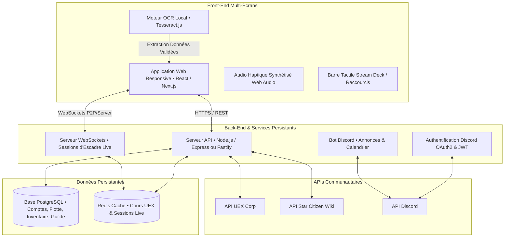

# 🧭 FEUILLE DE ROUTE OFFICIELLE — AARON MFD & MOBIGLAS OS 4.0
## Système d'Exploitation Tactique & Plateforme Collaborative (*Star Citizen 4.0+*)
### Architecture Complète • Modules Métiers • Sources de Données • Écosystème & Stack Technique

> **Statut du document** : **Document Maître de Référence Stratégique & Technique (Roadmap Officielle)**  
> **Orientation** : Transformer l'outil en un véritable compagnon tactique multi-écrans (cockpit, tablette, smartphone, desktop) et une plateforme collaborative d'organisation, persistante et interconnectée pour la boucle de jeu complète de Star Citizen 4.0+.

---

## 🌌 1. Les Modules Métiers Fondamentaux de l'Application

L'application s'articule autour de 8 modules interconnectés garantissant la boucle complète de gameplay industriel et militaire :

### 1.1. Compte & Profil Citoyen
* **Connexion & Authentification :** Espace personnel sécurisé, compatible session multi-appareils, Gestion mod de passe, email etc
* **Identité RSI :** Pseudo RSI officiel, indicatif radio (Callsign), spécialités déclarées (Mineur, Transporteur, Chasseur d'escorte, Prospecteur, Logisticien).


### 1.2. Flotte Personnelle & Hangar ASOP
* **Inventaire des Vaisseaux :** Registre complet des vaisseaux possédés, qu'ils soient issus de *pledges* sur le site RSI ou achetés *in-game* avec des aUEC.
* **Loadouts Détaillés par Vaisseau :**
  * **Armement :** Canons balistiques, répéteurs laser, missiles.
  * **Composants Systèmes :** Boucliers, générateurs d'énergie, refroidisseurs, moteurs quantiques (vitesse & portée).
  * **Équipements Industriels :** Têtes de minage (S1 / S2), sous-modules actifs/passifs (Surge, Stampede, Focus, FLTR).
  * **Composants Artisanaux :** Intégration transparente des têtes et armes forgées via l'Atelier de Crafting avec mention `✨ [CRAFTÉ]`.

### 1.3. Inventaire Unifié & Capture OCR
* **Avoirs Physiques Multi-Sites :** Minerais bruts, minerais raffinés, matériaux de recyclage (Salvage RMC, Construction Materials), cargaisons commerciales et objets craftés.
* **Inventaire d'Équipements & Provenance :** Enregistrement des composants de vaisseaux et équipements FPS (7 966 références FleetYards) avec traçabilité de provenance (Acheté, Trouvé / Looté, Crafté), cotation de vente en aUEC et options de troc alternatif.
* **Lieux de Stockage Précis :** Traçabilité exacte par conteneur physique (Soute de vaisseau, soutes détachables, hangars planétaires, inventaires locaux de stations orbitales).
* **Remplissage Intelligent par OCR :**
  * Capture d'écran instantanée du terminal de vente/raffinage en jeu (via touche F12 ou caméra).
  * Analyse optique locale (Tesseract.js) extrayant automatiquement les types de ressources, puretés et volumes en SCU.
  * **Étape de validation manuelle obligatoire :** L'utilisateur visualise la détection, ajuste d'un clic les éventuelles coquilles, puis valide l'enregistrement définitif dans ses stocks.

### 1.4. Minage, Prospection & Arbitrage Économique
* **Calculateur Tactique de Fracture :** Part d'un scan géologique (masse en kg, teneur minérale en %, résistance et instabilité thermique) pour calculer la faisabilité, la puissance laser requise (Watts) et la fenêtre optimale de tir.
* **Arbitre Vente Brute vs Raffinage :**
  * Comparateur en direct : Valeur nette de vente immédiate en minerai brut vs Valeur finale après raffinage.
  * **Optimisation du Raffinage :** Choix de la méthode (*Dinyx, Cormack, Ferron, Gencore, Pyrometric*), calcul des frais d'opération, du temps d'attente et prise en compte des bonus de rendement spécifiques par station (*ex: +10% Quantainium à ARC-L1, +7% Bexalite à MIC-L1*).

### 1.5. Fleets de Minage & Sessions Co-op
* **Création d'Escadre :** Formation d'un groupe multi-joueurs pour opérer sur des mégalithes colossaux.
* **Attribution des Rôles :**
  * *Foreuse Principale & Secondaire* (Prospector, MOLE, Orion).
  * *Transport & Logistique Cargo* (Hull, Raft, Taurus, C2 pour évacuer les sacs et conteneurs).
  * *Escorte Armée & Protection* (Gladius, Scorpius, Vanguard pour sécuriser la zone contre les pirates).
* **Session en Direct & Partage Automatisé des Gains :**
  * Télémétrie partagée en temps réel (lasers combinés et affaiblissement Lancet cumulé).
  * Calculateur financier automatique : déduction des dépenses de session (carburant, réparations, consommables), prélèvement de la taxe de guilde, puis génération des parts individuelles et ordres de virement `mo.Trader` copiables en 1 clic.

### 1.6. Blueprints & Atelier de Fabrication (Crafting 4.0)
* **Base de Données Codex des Blueprints :** Répertoire des plans de fabrication et guides explicatifs sur la façon de les obtenir dans le 'Verse (loot de caisses, épaves, réputation, factions de Stanton et Pyro).
* **Schémas Possédés par Joueur :** Registre personnel des plans débloqués, partagé avec l'organisation.
* **Vérification « Je peux crafter » (BOM Checker) :** Comparaison instantanée entre la nomenclature du blueprint et les ressources réellement disponibles dans l'inventaire personnel ou le stock de guilde (barres de progression visuelles).
* **Boucle Automatisée de Craft :**
  * Dès la fabrication validée, les matières premières sont déduites du stock.
  * L'objet crafté (tête de minage perfectionnée, module, arme) est **instantanément ajouté à l'inventaire** et devient immédiatement sélectionnable dans les loadouts de la flotte.

### 1.7. Bourse Commerciale & Optimisation Cargo
* **Calculateur Bidirectionnel :**
  * **Sens 1 (Vaisseau Actif ➔ Meilleures Routes) :** Classement des routes les plus lucratives selon la capacité de soute du vaisseau, son autonomie de saut quantique et le capital aUEC disponible du joueur.
  * **Sens 2 (Marchandise / Route ➔ Vaisseau Idéal) :** Recommandation automatique du vaisseau optimal pour une liaison donnée (compte tenu de la rentabilité, du risque et de la taille des aires d'atterrissage).
* **Indicateurs Financiers & Sécuritaires :** Investissement requis, bénéfice net par rotation, % ROI et niveau de menace pirate.

### 1.8. Quartier Général de Guilde & Opérations
* **Recrutement & Adhésion :** Dépôt de candidatures, validation par l'Amirauté et annuaire des membres.
* **Rôles & Permissions (RBAC) :** Gestion fine des accès (Commandant, Officier Logistique, Trésorier, Mineur, Escorte, Recrue).
* **Tableau de Bord 360° :** Vue consolidée des blueprints maîtrisés dans l'orga, des stocks communs multi-stations et de la trésorerie centrale.
* **Bourse Corporative & Commerce Inter-Guilde :** Marché interne de revente d'équipements entre membres, réservations de pièces rares et export de manifestes commerciaux inter-guildes au format Markdown pour Discord / Spectrum.
* **Ordres de Transfert Logistique :** Émission d'ordres de mission officiels pour déplacer du fret vers des stations stratégiques.
* **Section Dédiée aux Futures Bases :** Structure prête à accueillir le base building de CIG (gestion des avant-postes, claims territoriaux et silos de stockage planétaires).

---

## 🌟 2. Fonctionnalités Avancées & Écosystème Étendu

Ces fonctionnalités enrichissent le quotidien des joueurs et la vie des organisations :

1. **Journal de Session & Bilan de Rentabilité :**
   * Récapitulatif instantané : *« Ce que tu as gagné ce soir »*.
   * Historique chronologique et graphique de rentabilité par activité (Minage, Salvage, Commerce, Primes d'escorte).
2. **Trésorerie de Guilde & Banque d'Organisation :**
   * Gestion des cotisations des membres et des donations libres.
   * Suivi des dépenses opérationnelles (avances de fonds de commerce, primes de pertes de vaisseaux).
   * Répartition et redistribution automatisée des bénéfices d'opérations communes.
3. **Planning des Opérations & Intégration Bot Discord :**
   * Calendrier interactif des sorties de guilde avec inscriptions par rôle (mineurs, transporteurs, escorteurs).
   * Rappels automatiques avant mission.
   * **Bot Discord dédié :** Synchronisation directe des événements, annonces d'opérations et alertes sur les serveurs Discord de l'organisation.
4. **Carte Interactive du 'Verse :**
   * Visualisation spatiale des systèmes Stanton et Pyro.
   * Cartographie des points de vente, des raffineries et de leurs bonus, ainsi que des couloirs commerciaux recommandés.
5. **Système d'Alertes en Temps Réel :**
   * Notifications dynamiques : variation brutale d'un cours commercial (hausse/baisse), tâche de raffinage terminée à récupérer, ou rassemblement d'une flotte d'opération imminent.
6. **Gestion des Versions du Jeu (Patchs CIG 4.x) :**
   * Chaque mise à jour de Star Citizen modifie les prix, les statistiques des lasers et les tables de butin.
   * Toutes les données de l'application sont versionnées, datées et explicitement rattachées au patch du jeu actif (ex: *Build 4.0.1 Live / 4.1 PTU*).
7. **Matrice de Confidentialité & Protection des Données :**
   * Chaque joueur contrôle précisément la visibilité de ses données : il choisit ce que la guilde peut consulter (ex: partager la liste de ses vaisseaux et ses blueprints, mais garder son inventaire personnel ou son solde privés).

---

## 📡 3. Sources de Données & Intégrations Tiers (Le Point Critique)

> [!IMPORTANT]
> **Absence d'API Officielle CIG :** Cloud Imperium Games ne fournissant aucune API publique pour interroger directement la flotte ou l'inventaire en jeu d'un joueur, la plateforme s'appuie sur une combinaison intelligente de sources communautaires fiables et de saisie optique locale :

| Source / Plateforme | Type de Données Exploitées | Usage dans Aaron MFD |
| :--- | :--- | :--- |
| **[UEX Corp](https://uexcorp.space/)** | API REST des prix de commerce, cours des commodités et rendements des raffineries | Actualisation en direct des cours marchands, rentabilité des routes cargo et bonus de stations |
| **[Star Citizen Wiki API](https://api.star-citizen.wiki/)** | Données ouvertes sur les vaisseaux, caractéristiques techniques et fabricants | Fiches techniques complètes, capacités de soutes, dimensions et points d'emport |
| **[Regolith](https://regolith.rocks/)** | Algorithmes et tables de référence pour le minage et le split des gains | Formules de rentabilité minière, calculs de décomposition de roche et règles de partage équitable |
| **[Erkul Games](https://www.erkul.games/)** | Référentiel de référence pour les composants et les loadouts de vaisseaux | Données des armes, boucliers, propulseurs, têtes laser et statistiques de surchauffe |
| **Base Collaborative Interne** | Codex des Blueprints, recettes BOM et méthodes d'obtention 4.0+ | Données crowdsourcées et enrichies manuellement par la communauté au fil des patchs |

* **Conformité & Éthique :** Respect strict des conditions d'utilisation (ToS) de chaque API tierce, limitation des requêtes (caching intelligent) et conformité avec la *Fan Media Policy* de CIG.

---

## 💻 4. Architecture Technique Cible



1. **Application Web Multi-Écrans (React / Next.js) :**
   * Conçue pour être affichée en plein écran sur un second moniteur, une tablette cockpit posée à côté des commandes HOTAS, ou un smartphone.
   * Utilisation de CSS modulaire et de tokens de design pour une fluidité absolue sans latence.
2. **Back-End Persistant (Node.js / Python & PostgreSQL) :**
   * Base de données relationnelle robuste (PostgreSQL) garantissant l'intégrité des transactions de guilde, de l'inventaire et des loadouts.
3. **WebSockets pour les Fleets en Direct :**
   * Synchronisation temps réel des scans, de la puissance des lasers cumulés et de la répartition des gains au fur et à mesure de l'opération minière.
4. **OCR 100% Côté Navigateur (Tesseract.js) :**
   * Traitement d'image direct sur la machine du joueur, évitant tout transfert lourd de captures d'écran vers le serveur et garantissant la rapidité et la confidentialité.
5. **Connexion & Authentification via Discord :**
   * Connexion OAuth2 en un clic avec Discord, simplifiant drastiquement l'identification et la synchronisation avec les serveurs des organisations.

---

## 🚀 5. Ordre et Priorités d'Avancement (Les 6 Étapes Stratégiques)

Pour construire l'application de façon incrémentale et toujours opérationnelle :

```
┌──────────────────────────────────────────────────────────────────────────────────┐
│  ÉTAPE 1 (MVP) : Socle Comptes, Flotte & Loadouts, Inventaire manuel, Minage     │
├──────────────────────────────────────────────────────────────────────────────────┤
│  ÉTAPE 2 : Commerce & Raffinage connectés aux cours en direct (UEX Corp)         │
├──────────────────────────────────────────────────────────────────────────────────┤
│  ÉTAPE 3 : Fleets de Minage Co-op & Partage des Gains (Multi-Crew Splitter)      │
├──────────────────────────────────────────────────────────────────────────────────┤
│  ÉTAPE 4 : Quartier Général de Guilde : Membres, Rôles, Dashboard & Trésorerie   │
├──────────────────────────────────────────────────────────────────────────────────┤
│  ÉTAPE 5 : Codex Blueprints, Atelier Crafting 4.0 & Extraction OCR validée       │
├──────────────────────────────────────────────────────────────────────────────────┤
│  ÉTAPE 6 : Logistique de Guilde avancée & Intégration Base Building (futurs patchs)│
└──────────────────────────────────────────────────────────────────────────────────┘
```

### Étape 1 — Le MVP (Produit Minimum Viable)
* Comptes utilisateurs et profils citoyens (indicatif, localisation, vaisseau actif).
* Hangar de flotte personnelle et éditeur de loadouts (armes, composants, têtes laser).
* Registre d'inventaire physique saisi manuellement avec gestion multi-sites (stations et soutes).
* Calculateur de minage complet (analyse de scan, rentabilité, puissance de fracture).

### Étape 2 — Commerce & Raffinage Connectés (UEX Corp)
* Intégration de l'API UEX Corp pour synchroniser en temps réel les prix d'achat/vente des commodités et les coûts de raffinage.
* Moteur de calcul bidirectionnel pour le commerce cargo (Vaisseau ➔ Routes et Route ➔ Vaisseau idéal).
* Calculateur avancé de raffinage avec comparaison des rendements et bonus de toutes les stations.

### Étape 3 — Fleets de Minage & Partage des Gains
* Gestion de sessions de groupe avec affectation des rôles (mineurs, transporteurs, escorte armée).
* Télémétrie en direct via WebSockets : cumul de la puissance des lasers et réduction de résistance Lancet.
* Module de répartition financière automatisée (frais déduits, parts par métier et bordereaux `mo.Trader`).

### Étape 4 — Quartier Général de Guilde
* Gestion des candidatures, des membres et des permissions RBAC.
* Tableau de bord 360° de l'organisation (patrimoine global, répartition spatiale des avoirs).
* Module de trésorerie centrale : gestion des cotisations, registre des dépenses et caisse commune.

### Étape 5 — Blueprints, Crafting 4.0 & Scanner OCR
* Codex collaboratif des schémas de fabrication et méthodes d'obtention dans le 'Verse.
* Moteur de vérification de nomenclature BOM (*« Je peux crafter »*) connecté à l'inventaire réel.
* Déduction automatique des matières premières et injection de l'équipement crafté dans la flotte.
* Intégration de Tesseract.js dans le navigateur pour l'OCR automatique des terminaux avec validation manuelle.

### Étape 6 — Logistique de Guilde & Base Building
* Console de dispatching et d'ordres de transport de fret entre avant-postes et stations.
* Intégration du Base Building dès la publication des mécaniques par CIG (revendications territoriales, usines et silos modulaires).
* Bot Discord officiel d'organisation et synchronisation du calendrier d'opérations.

---

*Cette feuille de route constitue le document directeur officiel du projet AARON MFD & mobiGlas OS 4.0.*
