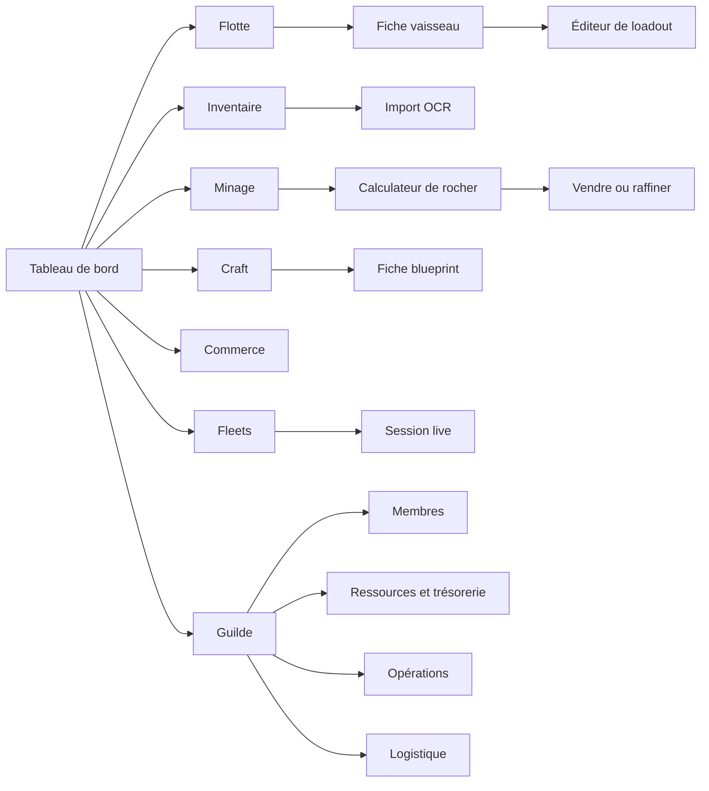

# 🛸 SYSTÈME DE DESIGN & CHARTE D'ERGONOMIE UI — AARON MFD
## Architecture d'Interface Spatiale & Écosystème Multi-Appareils (Star Citizen 4.x)
### Optimisé pour Deuxième Écran Cockpit • Tablette Tactile HOTAS • Smartphone • Desktop

> **Statut du document** : **Document Maître de Référence Graphique & Ergonomique (UI/UX)**  
> **Identité Officielle** : **`AARON MFD`** — Design sobre, moderne, dark navy slate (`#070b14` / `#0c1322`), typographie Segoe UI / Inter & JetBrains Mono, cartes épurées et contrastes optimisés pour la lisibilité en plein vol. Référence prototype disponible dans `/verse-ops-proto`.
> **Objectifs majeurs d'ergonomie** :
> 1. **Mode Deuxième Écran :** Thème sombre haute visibilité, session live lisible d'un coup d'œil en plein vol.
> 2. **Saisie Rapide (< 10 secondes) :** Calculateur de rocher express avec composition, instabilité et verdict économique instantané.
> 3. **Structure à 4 Zones sans Popups Bloquantes :** Remplacement des modales intrusives par le Tiroir d'Inspection Latéral (Slide-Over).

---

## 📐 1. Architecture Générale de l'Écran (App Shell VERSE OPS)

L'interface repose sur une structure fixe :

```
┌───────────────────────────────────────────────────────────────────────────────────────────────────────────────────────┐
│ 🛰️ 1. BARRE PERMANENTE (Vaisseau actif • Position • Solde • 🟢 Fleet • Version 4.x)                                   │
├──────────────┬────────────────────────────────────────────────────────────────────────┬───────────────────────────────┤
│              │                                                                        │                               │
│  2. BARRE    │                      3. ESPACE DE TRAVAIL CENTRAL                      │      4. TIROIR                │
│   LATÉRALE   │                   (L'Application Métier Active à 100%)                 │         D'INSPECTION          │
│   (8 ONGLETS)│                                                                        │         LATÉRAL               │
│              │   • Visualisation claire sans obstacle                                 │         (SLIDE-OVER)          │
│   [ ❖ 01 ]   │   • Cartes sombres modernes (border-radius: 8px, fond #0c1322)         │                               │
│   [ ✈ 02 ]   │   • Zéro popup intrusive au milieu de l'écran                          │  • Édition de loadout         │
│   [ ▤ 03 ]   │   • Données télémétriques en police Monospace sans tressautement       │  • Fiche blueprint & BOM      │
│   [ ⛏ 04 ]   │                                                                        │  • Import OCR & correction    │
│   [ 🛠 05 ]   │                                                                        │  • Split live mo.Trader       │
│   [ ⇄ 06 ]   │                                                                        │                               │
│   [ ⬡ 07 ]   │                                                                        │                               │
│   [ 🏛 08 ]   │                                                                        │                               │
│              │                                                                        │                               │
└──────────────┴────────────────────────────────────────────────────────────────────────┴───────────────────────────────┘
```

### Zone 1 — Barre Permanente Supérieure (TopBar — 48px)
* **Vaisseau Actif :** `MISC Prospector « Rockhound »`
* **Position :** `Stanton · ARC-L1`
* **Solde :** `1 284 500 aUEC`
* **Fleet :** `🟢 Opération Quanta`
* **Version :** `4.x`

---

## 🗂️ 2. Les 8 Écrans Métiers Organisés autour de la Barre Latérale



### 1. 📊 Tableau de Bord (Dashboard)
* **Synthèse Financière :** Bilan des gains de la semaine et rentabilité par activité.
* **Raffinages en Cours :** Cartes dynamiques des ordres de raffinage avec compte à rebours en direct (temps restant avant mise à disposition).
* **Opérations & Fleets Prévues :** Calendrier des prochaines sorties d'escouade et missions de guilde.
* **Alertes de Prix :** Variations fortes des cours marchands sur les terminaux TDD.
* **Raccourcis Tactiques Express :** Boutons d'accès direct en un clic vers *« Scanner un rocher »* et *« Meilleure route cargo »*.

### 2. 🚀 Flotte & Hangar ASOP
* **Grille de Cartes de Vaisseaux :** Une carte par vaisseau avec photo/silhouette, nom, rôle (Minage, Cargo, Combat), capacité de soute (SCU), loadout actif et bouton d'action *« Définir comme actif »*.
* **Fiche Vaisseau :** Caractéristiques détaillées (propulsion, vitesse quantique, autonomie, blindage) et liste des loadouts sauvegardés.
* **Éditeur de Loadout Interactif :**
  * Schéma visuel du vaisseau avec ses points d'emport (*hardpoints*) cliquables.
  * Pour chaque emplacement, filtrage automatique des objets compatibles en type et en taille (S1, S2, S3...).
  * **Distinction claire :** Badge distinct entre les objets déjà **présents dans l'inventaire** et ceux qu'il faudrait acheter en boutique.
  * **Colonne comparateur :** Tableau comparant les statistiques clés *Avant* et *Après* modification (puissance laser, consommation, portée, réduction de résistance).

### 3. 📦 Inventaire Unifié & Import OCR
* **Tableau de Stocks Multi-Localisations :** Filtrage par catégorie (*brut, raffiné, RMC, fret, crafté*), par lieu spatial (*soute vaisseau, station ARC-L1, HUR-L1, Pyro...*) et par qualité/tier.
* **Valorisation Immédiate :** Valeur unitaire et totale estimée en aUEC pour chaque ligne et cumul global.
* **Parcours d'Import OCR Fluide :**
  1. Déposez la capture d'écran du terminal (touche F12 ou caméra).
  2. Aperçu visuel avec mise en surbrillance des zones détectées.
  3. Tableau de prévisualisation éditable où les valeurs douteuses ou à faible confiance sont surlignées.
  4. Validation manuelle en un clic pour injecter les lots vérifiés dans l'inventaire.

### 4. ⛏️ Minage & Aide à la Décision
* **Calculateur de Rocher Express (< 10 secondes) :**
  * Saisie rapide au pouce ou curseurs : masse (kg), instabilité, résistance et pourcentages de minerais (ou extraction OCR instantanée).
  * Verdict d'un coup d'œil : *Faisable en solo avec ton vaisseau actif OU Nécessite une fleet de minage*.
  * Valeur brute estimée de la roche.
* **Vendre ou Raffiner (Comparatif Côte à Côte) :**
  * **Colonne Vente Brute :** Meilleur terminal TDD immédiat et prix net en aUEC.
  * **Colonne Raffinage Optimisé :** Comparatif exhaustif par méthode (*Dinyx, Cormack, Ferron, Gencore*) et par station (*ARC-L1, HUR-L1, CRU-L1...*) avec rendement net (SCU), durée du procédé, coût de traitement et gain net.
  * **Mise en avant visuelle dorée de la meilleure option économique.**

### 5. 🛠️ Crafting & Codex Blueprints 4.0
* **Catalogue de Schémas :** Grille des schémas de fabrication avec 3 filtres exclusifs :
  * 🟢 *Possédés* (débloqués par le joueur).
  * ✨ *Craftables maintenant* (tous les ingrédients sont disponibles à 100% dans l'inventaire).
  * 🔴 *Manquants* (schémas encore non trouvés dans le 'Verse).
* **Fiche Blueprint Détaillée :**
  * Nomenclature BOM (Bill of Materials) : liste des ingrédients avec pour chacun la quantité en stock, la quantité requise et un indicateur couleur vert/rouge.
  * Guide lore d'obtention : coordonnées dans Stanton/Pyro, type d'épave ou niveau de réputation nécessaire.
  * Bouton d'action *« Crafter »* : déduit automatiquement les matières premières de l'inventaire et ajoute instantanément le composant fini aux loadouts des vaisseaux.

### 6. 📈 Bourse Commerciale & Routes Cargo
* **Vue « Avec mon vaisseau » :** Classement des routes commerciales par profit horaire net (*aUEC/heure*), calculé selon la capacité de soute réelle de votre vaisseau actif, son autonomie de saut quantique et le capital d'investissement que vous indiquez.
* **Vue « Pour cette route » :** Vous choisissez une marchandise ou une liaison, et l'app classe les vaisseaux les plus adaptés en précisant si vous les possédez déjà dans votre flotte.
* **Fiche Trajet Détaillée :** Prix d'achat, prix de vente, distance en millions de kilomètres, niveau de risque pirate et **fraîcheur de la donnée** (temps écoulé depuis la dernière mise à jour de l'API UEX).

### 7. 👥 Fleets & Sessions Co-op
* **Gestion des Fleets :** Liste des escadres ouvertes ou privées de votre guilde, avec module de création paramétrable (type d'opération, rôles attribués, pourcentages de split).
* **Console de Session Live (Temps Réel) :**
  * Membres connectés, vaisseaux engagés et rôles (*foreuse, cargo, escorte*).
  * Compteur de rochers scannés et brisés en direct.
  * Volume total de minerais extrait.
  * Raffinages d'escadre en cours.
  * **Répartition financière mise à jour en direct :** Part individuelle recalculée à chaque rocher, avec génération des ordres de virement `mo.Trader` copiables d'un tap.

### 8. 🏛️ Quartier Général de Guilde
*(Réservé aux membres accrédités, affichage conditionné par le rôle)*
* **Membres & Recrutement :** Tableau des candidatures à valider ou rejeter, gestion des rôles et matrice des permissions RBAC.
* **Ressources & Trésorerie :**
  * Inventaire consolidé de l'ensemble de la guilde réparti par stations.
  * Répertoire des blueprints maîtrisés collectivement (qui sait crafter quoi).
  * Solde de la caisse commune et grand livre comptable des transactions.
* **Opérations :** Calendrier interactif des sorties minières, de sauvetage ou de combat avec inscriptions des pilotes par rôle.
* **Logistique (Tableau Kanban) :** Ordres officiels de déplacement de ressources organisés en colonnes Kanban (*À traiter ➔ En transit ➔ Livré*), avec lieu de départ, destination, pilote assigné et statut d'acheminement.

---

## 🎨 3. Spécifications Ergonomiques & Esthétiques Star Citizen

### A. Le Mode "Deuxième Écran" (Second Screen Experience)
* **Contrainte Cockpit :** L'écran est souvent posé à côté du joystick HOTAS ou au-dessus de la manette des gaz, dans une pièce sombre.
* **Principes Appliqués :**
  * Fond noir bleuté ultra-profond (`#030712` et `#050811`) garantissant un contraste exceptionnel sans éblouir le pilote.
  * Typographies aérospatiales géantes (`Orbitron`, `Chakra Petch` et `JetBrains Mono`) pour une lecture instantanée d'un simple coup d'œil pendant les manœuvres de vol.
  * Cartes CIG biseautées avec liseré néon dynamique indiquant le statut opérationnel.

### B. Le Principe de Saisie Rapide (< 10 Secondes)
* Le pilote ne peut pas lâcher ses commandes plus de quelques instants lors d'un vol stationnaire dans l'Aaron Halo.
* L'écran de Minage intègre des boutons de préréglages instantanés (+1000 kg, curseurs tactiles à glissement, raccourci caméra OCR F12) permettant d'obtenir le verdict économique en moins de 10 secondes chrono.

---

*Ce document est la référence ergonomique et fonctionnelle pour le développement des écrans de la plateforme AARON MFD.*
